# نهج على iPhone Duo — جودة الامتداد الكامل والتكيّف (13 نوفمبر 2026)

نطاق هذه الجولة طبقة العرض فقط:
- [src/duo-adaptive.css](../src/duo-adaptive.css): ملف جديد يُحمَّل أخيراً من [src/main.tsx](../src/main.tsx).
- سطر `viewport` وقاعدتا الحواف الآمنة في `BASE_STYLE` بملف [server/marketingPages.ts](../server/marketingPages.ts). هذا قالب HTML لصفحات التسويق، ولا يمسّ أي مسار ولا منطق.
- ثلاثة اختبارات حراسة جديدة في [server/duoLayout.test.ts](../server/duoLayout.test.ts). الاختبارات القديمة لم تُغيَّر.

لم يُمَسّ سلّم الاعتماد ولا السياسات ولا المصادقة ولا Firestore ولا الدفع ولا البيانات ولا الـ API، ولا `cloudbuild.yaml` و`firebase.json` والـ workflows، ولا غلاف iOS.

رموز الحالة: `PASS` تحقق مُشاهَد أو مُختبَر، و`PARTIAL` جزئي، و`FAIL` خلل باقٍ، و`BLOCKED` يحتاج جهازاً أو إذناً، و`NOT_APPLICABLE` غير ذي صلة، و`NOT_TESTED` لم يُختبر.

> ملاحظة: ملف التعليمات الرئيسي `~/Desktop/00_MASTER_CLAUDE_CODE_AR.txt` لم يكن موجوداً على القرص في هذه الجولة. اعتمدتُ تعريفات الوضعيات A–J المستعملة في المستودعات الشقيقة (Orbit وMizan)، ومواصفة `DUO_BRIEF.md`، وحدود `RUN_2026-11-13.md`.

## 1. نوع المشروع ومسار العرض

- **الويب:** React 19 + Vite 6 + Tailwind 4، يخدمه Express ([server.ts](../server.ts)). التطبيق في `/app`: الدخول، ثم الغلاف (`.desktop-rail` و`.topbar` و`.content-stage`، و`.mobile-dock` على الهاتف)، و17 قسماً، ونافذة الاعتماد. صفحات التسويق (`/` و`/pricing` والصفحات القانونية) HTML يولّده الخادم.
- **الطبقات:** `index.css` ثم عشر طبقات تحسين من الجولات السابقة (`duo.css` و`duo-beauty-*` و`responsive-2026-11.css`…). هذه الجولة لم تُعِد بناء ما فيها، وأضافت طبقة واحدة تصلح الجذور.

## 2. خط الأساس قبل التعديل (`origin/main` = `8869a31`)

| الفحص | النتيجة |
|---|---|
| `npm ci` | PASS |
| `npm run lint` / `typecheck` (`tsc --noEmit`) | PASS |
| `npm test` | PASS: 340/340 |
| `npm run build` | PASS |
| مصفوفة WebKit (13 مقاساً × 13 شاشة) | لا تمرير أفقي ولا أخطاء JS. وظهرت عيوب القسم 3 |

لم يكن على `main` أي فشل سابق.

## 3. ما وُجد وما أُصلح من جذوره

| # | العَرَض (قبل) | الجذر | الإصلاح |
|---|---|---|---|
| 1 | **نافذة الاعتماد** على 951×600 (مفتوح عرضي) و951×350 (لوحة مثبتة): زرّا «اعتمد ونفّذ» و«استلم الحالة» تحت حافة النافذة، ولا يظهر القرار إلا بتمرير السجل كله | شريط القرار اللاصق مكتوب داخل `@media (max-width: 900px)`، فالعرض هو الحَكَم لا الارتفاع المتاح | الشريط لاصق في كل المقاسات، والنافذة بارتفاع `100dvh` ناقص الحواف الآمنة، وتتمرّر من داخلها. على الارتفاع ≤ 420 يصغر رأس النافذة. لم يتغيّر ترتيب الأزرار ولا شروط تفعيلها |
| 2 | **الحواف الآمنة معكوسة في RTL:** `padding-inline: max(…, env(safe-area-inset-left)) max(…, env(…-right))` في `.content-stage`، وكذلك `.mobile-dock` و`.desktop-rail`. في العربية بداية السطر هي اليمين، فيُعطى اليمين حافة اليسار. في الآيفون العرضي والكاميرا على اليمين تبقى أيقونات الشريط الجانبي تحت الكاميرا. وفي الإنجليزية ينعكس رأس الصفحة بالطريقة نفسها | قيم `env()` فيزيائية داخل خصائص منطقية، ولا ترجمة حسب الاتجاه | tokens فيزيائية (`--safe-t/r/b/l`) تُترجَم مرة واحدة إلى `--safe-start/end` على كل عنصر يحمل `dir`. الشريط الجانبي يتّسع بمقدار الحافة الآمنة على جهته (والخلفية ممتدة حتى الحافة)، و`.shell-body` يتبعه، والجهة الأخرى للرأس والمحتوى تبتعد عن الكاميرا. وكذلك الشريط السفلي وزر الإيقاف والتنبيه وقائمة «المزيد» وستار النوافذ |
| 3 | **عرض الشريط الجانبي** تقرّره ثلاث طبقات (208 و84 و132 بعمودين) | — | `--rail-w` يكرّر نقاط الكسر نفسها ولا يغيّر العرض، ويضيف إليه الحاجز الآمن فقط. أول محاولة فرضت 84px فضغطت الشريط ذا العمودين (ارتفعت أهداف اللمس الصغيرة من 0 إلى 14–18). كشفتها المصفوفة وصُحِّحت قبل الـ PR |
| 4 | **الدخول** على 951×350 و844×390: البطاقة عمود واحد يتجاوز الشاشة، وزرّ الدخول تحت الحافة. وارتفاع الصفحة `100vh` (الارتفاع الكبير في Safari)، فيظهر تمرير زائف والشريط ظاهر | الارتفاع القصير مع العرض الواسع لا تخطيط له، و`.login-shell` غير مشمول بقاعدة `100dvh` في `duo.css` | `.login-shell` بـ `100dvh` وحشوة تحترم الحواف الأربع. وفي `(min-width: 700px) and (max-height: 500px)` تنقسم البطاقة لوحتين: الهوية والتعليمات، ثم الحقول والزر. الزر الآن داخل الشاشة الأولى |
| 5 | **أهداف لمس 34–41px** على 951 بمؤشر لمس: إغلاق النافذة 34×34، واختيار القطاع 34px، وزر «جرّب نهج» 38×38، وزرّا القرار 41px، والبحث 41px | قاعدة الـ 44px مكتوبة لـ `max-width: 900px`، وDuo المفتوح يعطي 951px بمؤشر لمس | الحكم بـ `(pointer: coarse)`. صار عدد الأهداف الصغيرة على 951×600 و951×350 صفراً، بعد أن كان 1 إلى 3 |
| 6 | **صفحات التسويق** بلا `viewport-fit=cover`: في الآيفون العرضي يضع Safari الصفحة داخل إطار، فلا تمتد الترويسة اللاصقة ولا الخلفيات حتى الحافة | سطر `viewport` في قالب `page()` | `viewport-fit=cover`، و`.wrap` و`.doc-layout` بحشوة فيزيائية تشمل الحافة الآمنة، والتذييل فوق مؤشر الشاشة الرئيسية |

## 4. فحص الامتداد الكامل

| البند | الحالة | الدليل |
|---|---|---|
| خلفية الجذر | PASS | `html` و`body` يحملان `--paper`، و`.app-shell` و`.login-shell` و`.boot-gate` و`.org-setup` بـ `100dvh`، والتدرجات ثابتة `inset: 0` |
| الحواف الأربع والحواف الآمنة | PASS في محاكاة | حواف Playwright صفر، فحاكيتُ الكاميرا بتجاوز `--safe-r/--safe-l` إلى 47px. على 844×390 RTL والكاميرا يميناً تنتقل أيقونات الشريط من 831 إلى 784 (= 844−47−13)، والخلفية باقية حتى 837. والكاميرا يساراً تبعد أزرار الرأس إلى x=51. وفي LTR يميناً ويساراً بالمقدار نفسه. وعلى 390×844 يبتعد الشريط السفلي 47px. **لم يُقَس على جهاز** |
| تمرير أفقي | PASS | صفر في 13 مقاساً × 13 شاشة (WebKit)، وفي كل خطوات الانتقال الحي |
| `overflow: hidden` على الجذر | PASS | يُستعمل `overflow-x: clip` تحت 900px فقط (من جولة سابقة)، ولا يقصّ شيئاً مرئياً |
| لوحة المفاتيح | NOT_TESTED | المحاكي لا يُظهر لوحة مفاتيح حقيقية. حقول الدخول والسبب بخط 16px، فلا يكبّر Safari الصفحة |

## 5. مصفوفة الوضعيات A–J

المنصة: Playwright WebKit (ملف Safari المحمول بـ UA الـ Duo، لمس، تقليل الحركة). الشاشات: الرئيسية والأسعار والدخول، ثم اليوم والعمل ونافذة الاعتماد والمهارات والحوكمة والأثر والسجل والتعلّم والربط و«المزيد».

| الوضعية | المقاس | الدخول | الغلاف والأقسام | نافذة الاعتماد | التسويق | الحالة |
|---|---|---|---|---|---|---|
| A مطوي طولي | 382×580 | ✓ | ✓ (شريط سفلي) | ✓ الشريط لاصق | ✓ | PASS (محاكاة) |
| B مطوي عرضي | 594×368 | ✓ | ✓ شريط جانبي بعمودين | ✓ | ✓ | PASS (محاكاة) |
| C مفتوح طولي | 669×880 | ✓ | ✓ قائمة + تفاصيل | ✓ | ✓ | PASS (محاكاة) |
| D مفتوح عرضي | 951×600 | ✓ | ✓ | **كان FAIL:** الأزرار تحت الحافة. **الآن ✓** | ✓ | PASS (محاكاة) |
| E كتاب | 669×880 مع مفصل عمودي | — | — | — | — | BLOCKED: Viewport Segments API خلف علم في Safari 27.1. والمستودع يحرس صراحة ألا يعتمد أي تخطيط عليها (`duoLayout.test.ts`)، فلم تُضَف كتل segments |
| F طاولة | 951×600 مع مفصل أفقي | — | — | — | — | BLOCKED للسبب نفسه. الصفحات قابلة للتمرير، ولا شيء مثبّت على خط y≈300 سوى الرأس |
| G نافذتان | 385×571 | ✓ | ✓ | ✓ | ✓ | PASS (محاكاة) |
| H Split | 320 / 470 / 620 ×600 | ✓ | ✓ | ✓ | ✓ | PASS (محاكاة) |
| I خيمة/حامل | — | — | — | — | — | NOT_TESTED: لا runtime يعلن هذه الوضعية |
| J انتقال حي | 951×600 ← 669×880 ← 470×600 ← 382×580 ← 594×368 ← 951×350 ← 951×600 بلا إعادة تحميل | — | — | النافذة باقية مفتوحة، والسبب المكتوب باقٍ، وشريط القرار ظاهر في كل خطوة | — | PASS |

مقاسات إضافية: 669×520 (لوحة مثبتة)، و951×350، وiPhone 390×844، وiPhone عرضي 844×390، وسطح المكتب 1440×900. كلها بلا تمرير أفقي.

ملاحظة على سطح المكتب 1440×900: بقي فيه 21–27 هدفاً أصغر من 44px، وهو كذلك قبل التعديل. هذا مؤشر فأرة (`pointer: fine`)، وتصميم الكثافة هناك مقصود، فلم يُغيَّر.

وفي الصفحة الرئيسية حقل `label.hp` خارج الشاشة. هو حقل فخّ مقصود ضد البوتات، ولا يسبب تمريراً.

## 6. صور قبل/بعد

| الحالة | قبل | بعد |
|---|---|---|
| D نافذة الاعتماد 951×600 | 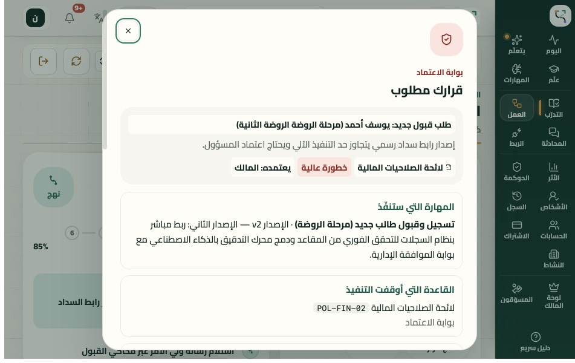 | 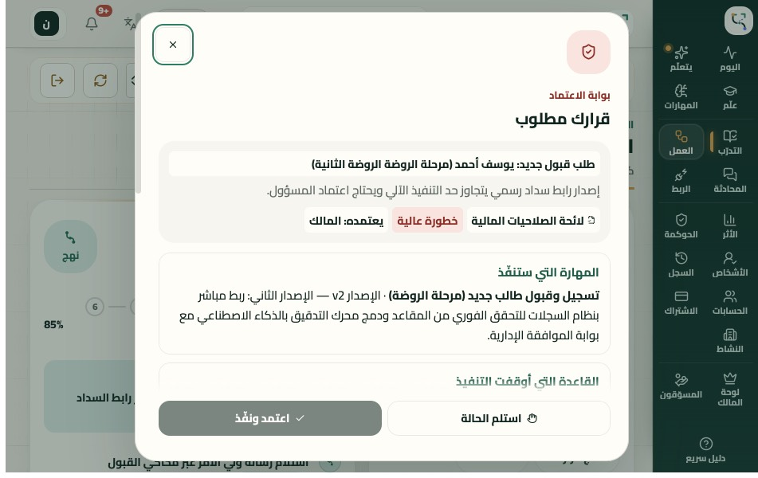 |
| نافذة الاعتماد 951×350 | 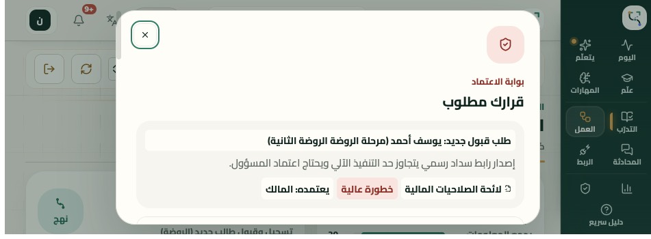 | 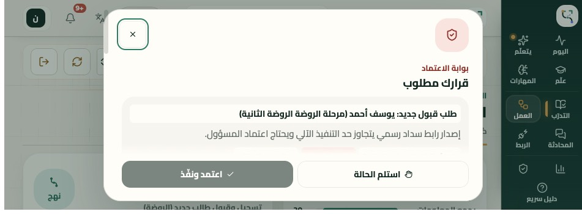 |
| الدخول 951×350 | 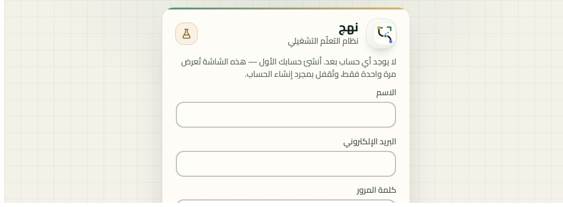 | 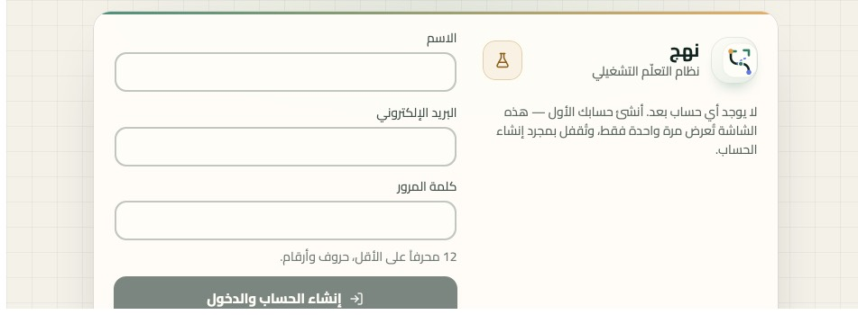 |
| B نافذة الاعتماد 594×368 (بلا تغيير مقصود) | 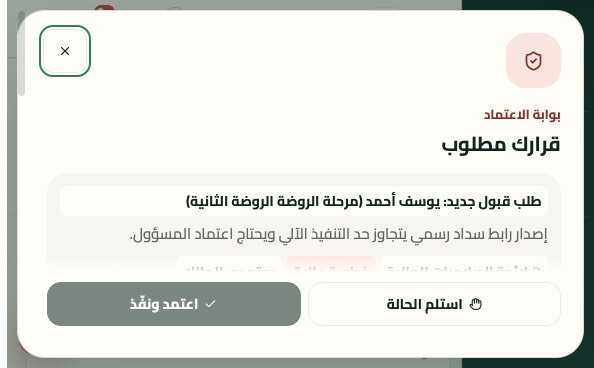 | 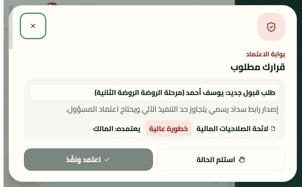 |
| A اليوم 382×580 (بلا تغيير مقصود) | 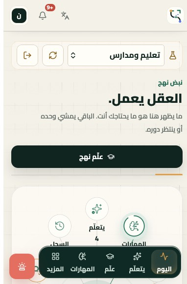 | 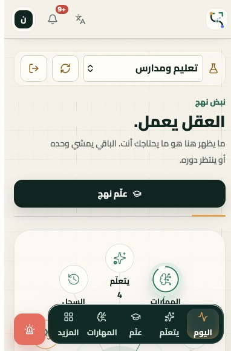 |
| C اليوم 669×880 (بلا تغيير مقصود) | 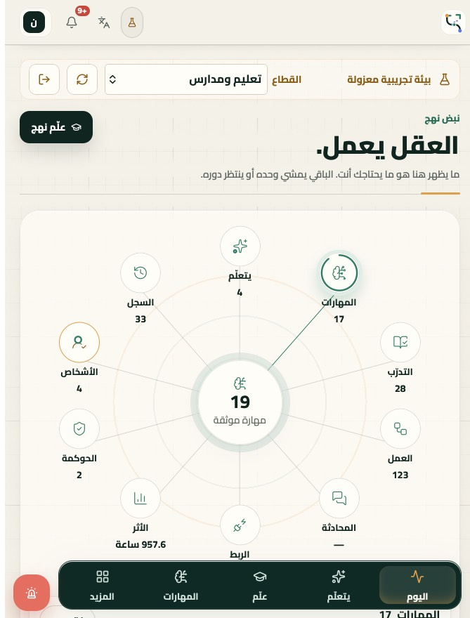 | 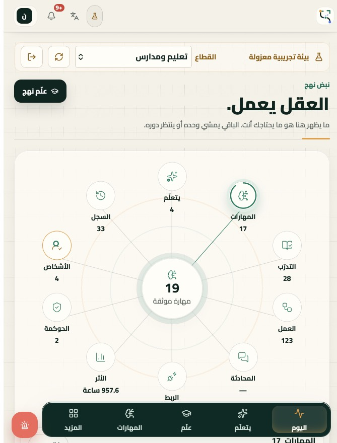 |
| محاكاة الكاميرا يميناً 844×390 RTL | | 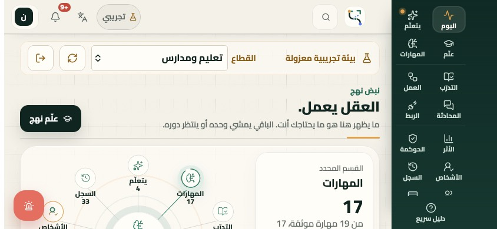 |
| محاكاة الكاميرا يساراً 844×390 LTR | | 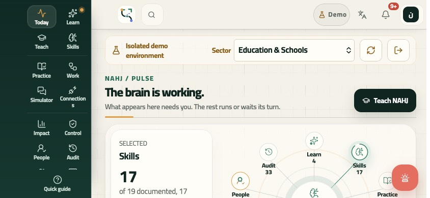 |
| J بعد الانتقال إلى 382×580 ثم 951×350 | 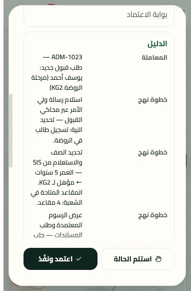 | 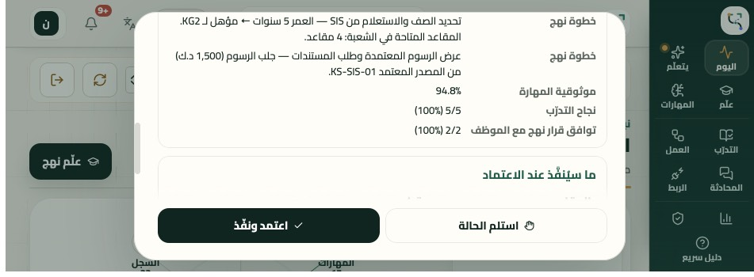 |

## 7. الوصول والاتجاه

- RTL: الواجهة `dir=rtl`، والإنجليزية `dir=ltr` تُحوِّل الحواف الآمنة معها تلقائياً. PASS.
- التكبير غير مقفول (`width=device-width, initial-scale=1.0, viewport-fit=cover`)، و`touch-action: manipulation` على عناصر اللمس. PASS.
- أهداف اللمس ≥ 44px في كل مقاس بمؤشر لمس. PASS.

## 8. النشر

الدمج في `main` **لا ينشر**: مُشغِّل Cloud Build `nahj-deployer` معطَّل، و`.github/workflows/deploy.yml` مسار VM احتياطي غير مفعّل (انظر [docs/deploy-nahj.md](deploy-nahj.md)). والإنتاج (`https://nahj-os.web.app`، Cloud Run `nahj`) يُنشر يدوياً:

```sh
gcloud builds submit --config cloudbuild.yaml --substitutions=COMMIT_SHA=$(git rev-parse HEAD) --project nahj-a27a4
```

حدود هذه الجولة لا تسمح بنشر يدوي بـ gcloud من هذا الجهاز ولا بـ workflow غير موجود، فالنشر `BLOCKED` إلى أن يشغّل المالك الأمر أعلاه من نسخة نظيفة من `main` المدموج. للتحقق بعده: `https://nahj-os.web.app/api/health`، وأن يحوي ملف CSS الحي القاعدة `--safe-start`.

## 9. ما يجب فحصه على جهاز حقيقي

1. آيفون عرضي (والكاميرا يميناً ثم يساراً): أيقونات الشريط الجانبي وزر الإيقاف لا تقع تحت الكاميرا.
2. Duo مفتوح عرضياً: افتح «قرار مطلوب» من «العمل». زرّا القرار ظاهران بلا تمرير.
3. Duo مطوي ↔ مفتوح ونافذة الاعتماد مفتوحة وفيها سبب مكتوب: يبقى السبب وتبقى النافذة.
4. صفحة `/` على آيفون عرضي: الترويسة والخلفية تمتدان حتى الحافة، والنص خارج منطقة الكاميرا.
5. وضعا الكتاب والطاولة (E/F) حين تُفعَّل Viewport Segments.
