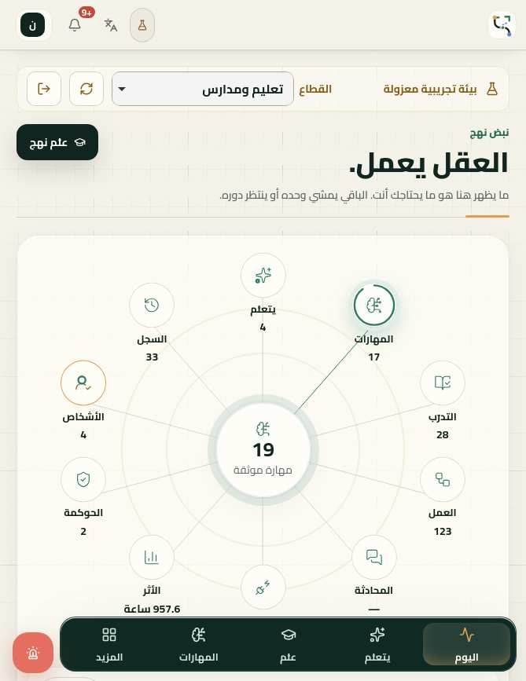
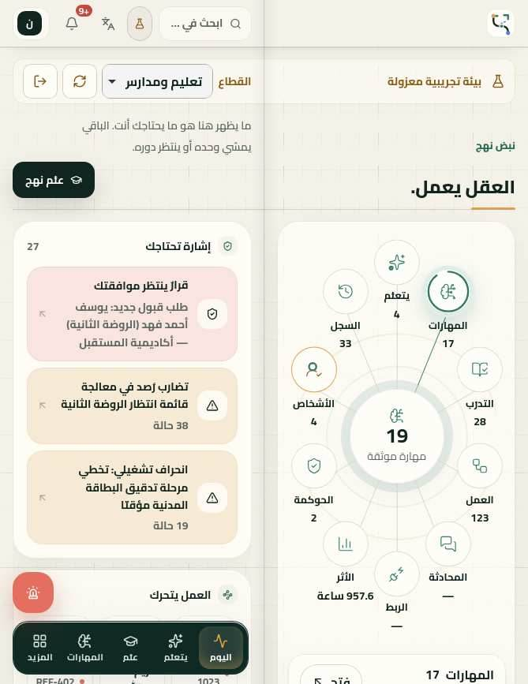
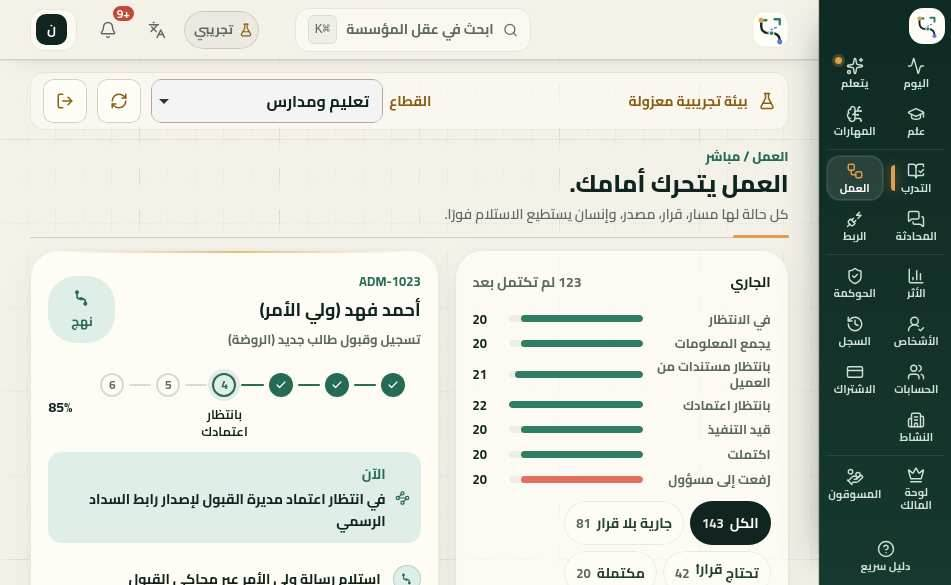
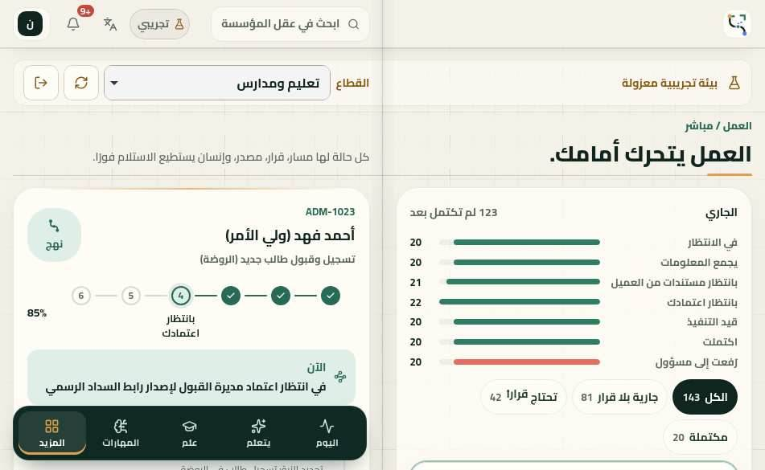
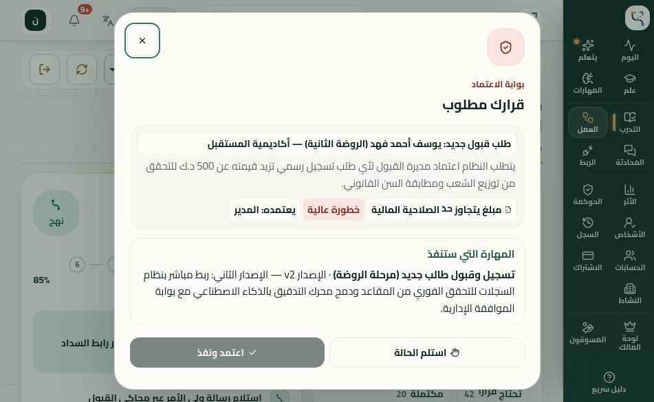
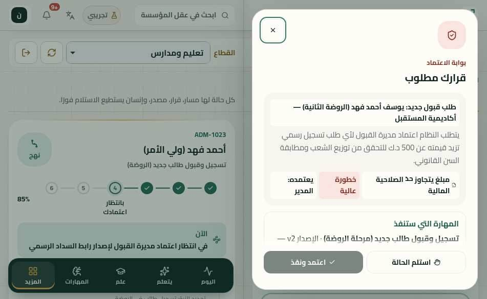
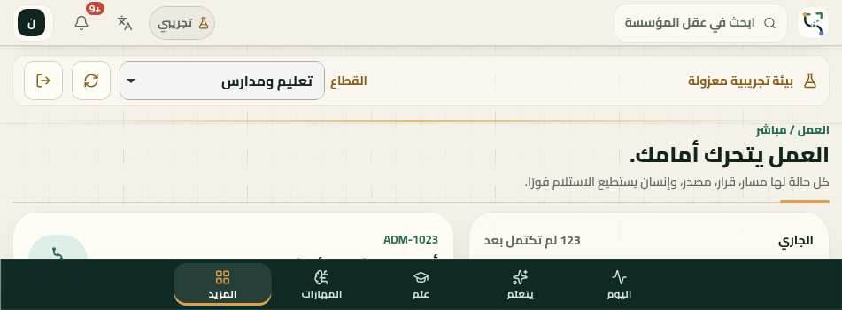

# نهج على iPhone Duo — قبول الجولة الأخيرة: وضع الكتاب ومصفوفة الوضعيات (14 نوفمبر 2026)

هذه الجولة تبني على [IPHONE-DUO-ADAPTIVE-QUALITY.md](IPHONE-DUO-ADAPTIVE-QUALITY.md) ولا تعيد ما حُلّ فيها (الحواف الآمنة بجهاتها، وشريط القرار اللاصق، ولوحتا الدخول في الارتفاع القصير).

**النطاق: طبقة العرض وحدها.**
- [src/duo-adaptive.css](../src/duo-adaptive.css): الأقسام ٥ (وضع الكتاب) و٦ (وضع الحاسوب)، وقائمة «كل الأقسام» فوق 900px، وأهداف لمس.
- [src/components/views/DemoOwnerPreview.tsx](../src/components/views/DemoOwnerPreview.tsx): الجذر صار `<div className="page-enter">` بدل `<>`، كبقية الأقسام، فيوزّعه وضع الكتاب على الصفحتين. لا تغيير في البيانات ولا النصوص.
- [server/duoLayout.test.ts](../server/duoLayout.test.ts): اختباران جديدان. الاختبارات القديمة كما هي.
- [docs/iphone-duo-final/audit.cjs](iphone-duo-final/audit.cjs): سكربت التدقيق، وصور قبل/بعد.

لم يُمسّ سلّم الاعتماد ولا السياسات ولا المصادقة ولا Firestore ولا الدفع ولا البيانات ولا المسارات ولا الـ workflows ولا النشر.

رموز الحالة: `PASS` مقيسٌ ومُشاهَد في الصور، و`PARTIAL` يعمل مع ملاحظة، و`FAIL` خلل باقٍ، و`BLOCKED` لا يُبلغ بلا بيانات أو صلاحية حقيقية، و`NOT_TESTED` لم يُختبر. كل الاختبارات في Playwright WebKit (UA سفاري الهاتف، لمس، `deviceScaleFactor: 1`). **لم يُختبر شيء على جهاز حقيقي.**

## 1. المشكلة والتصميم

على الشاشة الداخلية (≈669×867 طولياً و≈951×585 عرضياً) كانت الواجهة صفحة iPad ممطوطة: شريطٌ جانبي وعمودٌ واحد يعبر منتصف الشاشة. قِيس ذلك قبل التعديل: **303 نصّاً أو عنصراً تفاعلياً يقطع منطقة الكعب على 669×867، و276 على 951×585** (25 حالة في كل مقاس).

Safari لا يكشف المفصل، فالقرار بالمقاس وحده (وكل القواعد مقيّدة بـ `screen`):
- كتاب طولي: `640–720 × ≥760`. كتاب عرضي: `860–1000 × 520–760`. فلا يقع فيه iPad طولي (768×1024) ولا 1024×768 ولا 669×520.

**التركيب:**
- **صفحتان متقابلتان** وكعبٌ هادئ عرضه 32px (`--spine`): خيطٌ وسطي وظلّ طيّ خفيف، لا يلتقط اللمس. والخلفية متصلة من الحافة إلى الحافة، والحاشية متناظرة (`max(16px, safe-l, safe-r)`) فيبقى الكعب في منتصف الشاشة حتى مع حافة آمنة على جهة واحدة.
- **اليمنى (البداية في RTL) للمهمة**: القائمة أو القراءة أو المحادثة أو الخريطة. **اليسرى للسياق**: لوحةٌ واحدة بطول الصفحة **تلصق تحت الرأس** فتبقى أمام العين بينما تتمرّر المهمة.
- **رأس القسم سطرٌ يقسمه الكعب**: العنوان يميناً، والتمهيد وزرّ القسم يساراً.
- **الرأس العام**: الهوية يميناً، والبحث والأدوات يساراً. **شريط العرض التجريبي**: الوصف يميناً، والقطاع والأزرار يساراً.
- **الفهرس (التنقّل)** ينتقل من الشريط الجانبي إلى أسفل الصفحة اليسرى، و«المزيد» يفتح كل الأقسام على الصفحة اليسرى. زرّ الإيقاف الطارئ فوق الفهرس عند الحافة الخارجية.
- **النوافذ**: الستار بعرض الشاشة كلها ويحجب اللمس. الاعتماد والإيقاف والترقية والبحث على اليمنى، والدليل على اليسرى.

| القسم | اليمنى (المهمة) | اليسرى (السياق، لاصقة) |
|---|---|---|
| اليوم | خريطة العقل التشغيلي + النبض + الذاكرة | «إشارة تحتاجك» و«العمل يتحرك» |
| يتعلّم | موجز الإشارات | رادار الإشارات |
| علّم | منصة الجلسة | الالتقاط المباشر |
| المهارات | خريطة المهارات | مفتش المهارة المختارة |
| التدرّب | مسار التخرّج + التقييم | مقارنة الظل |
| العمل | طابور الحالات والفلاتر | الحالة المختارة ومسارها |
| المحادثة | الهاتف والمحادثة | أثر المحادثة |
| الربط | حالة المرآة + قائمة الموصلات | خريطة الأنظمة |
| الأثر | الأثر والمقاييس والأسبوع والمخاطر | أكثر المهارات أثراً |
| الحوكمة | الدرع + سلّم الاستقلالية | حواجز القرار |
| الأشخاص | التغطية + المصفوفة + القائمة | مخاطر الشخص الواحد |
| السجل | الخط الزمني للأدلة | الكثافة والأنواع والبحث و«عرض المزيد» |
| الحسابات | قائمة الحسابات | كلمة مروري + حساب جديد |
| الاشتراك | الحالة والاستهلاك والتصدير والسجلات | الباقات |
| النشاط | الأنشطة الجاهزة | الملاحظة + من يحادث مؤسستك |
| لوحة المالك / المسوّقون (معاينة العرض) | الملاحظة والجداول | المؤشرات |
| الدخول | الهوية والتعليمات | النموذج في بطاقة |
| إعداد المؤسسة | الاسم والملاحظة وزرّ البدء | القطاعات |

**الآلية:** `.page-enter` (جذر كل قسم) شبكةٌ بعمودين متساويين بينهما فاصلٌ بعرض الكعب. وحاويات «قائمة | تفاصيل» تصير `display: contents`، فيُوزَّع أبناؤها بلا تغيير في الشجرة ولا JS ولا إعادة تركيب. لذا تبقى الحالة عبر تغيّر المقاس.

جُرِّب العمود المتعدد (`columns: 2`) أولاً ثم تُرك: WebKit لا يرسم العنصر الموضَّع (`position: relative` في `.surface-strong`) إذا وقع في العمود الثاني. يُلمس ولا يُرى. والاختبار الجديد يمنع العودة إليه.

**وضع الحاسوب (E) والارتفاع القصير العريض (B، 844×390):** `≥560 × ≤430`. المحتوى بالعرض كله، والرأس يتمرّر مع الصفحة، والأدوات شريطٌ ملتصق بالحافة السفلية بعرض الشاشة وأزراره في الوسط. وللمحتوى حشوةٌ سفلية بارتفاعه، و`scroll-padding-bottom` يمنع الحقل المركَّز من الاختفاء تحته. هذا يستبدل الشريط الجانبي ذا العمودين في الارتفاع القصير (الجولات 117–119) بشريطٍ سفلي، كما تطلب مواصفة وضع الحاسوب.

**مفصل حقيقي (Viewport Segments):** لم يُضَف. المستودع يحرس صراحةً ألا يعتمد أي تخطيط على `viewport-segments` أو `device-posture` ([duoLayout.test.ts](../server/duoLayout.test.ts))، وWebKit لا يحاكيها. الحالة: `NOT_TESTED`. والكعب في المنتصف الهندسي، وهو موضع المفصل في الوضع الكامل.

## 2. جرد الشاشات (من `App.tsx` و`Shell.tsx`)

| # | الشاشة | كيف بُلغت |
|---|---|---|
| 1 | الدخول (إنشاء أول حساب / تسجيل الدخول) | سياق مجهول |
| 2 | إعداد المؤسسة (`OrgSetupView`) | حساب محلي في قاعدة الذاكرة (`NAHJ_DATABASE_PATH=:memory:`) |
| 3–19 | الأقسام السبعة عشر: اليوم، يتعلّم، علّم، المهارات، التدرّب، العمل، المحادثة، الربط، الأثر، الحوكمة، الأشخاص، السجل، الحسابات، الاشتراك، النشاط، لوحة المالك، المسوّقون | الصندوق التجريبي المعزول (`/api/demo/enter`) |
| 20 | نافذة الاعتماد | زر التنبيهات |
| 21 | نافذة الإيقاف الطارئ | الزر العائم، أو «إيقاف طارئ» في الحوكمة فوق 900px |
| 22 | نافذة مراجعة الترقية | سلّم الاستقلالية في المهارات (فتحٌ فقط، بلا ترقية) |
| 23 | لوحة البحث والتنقّل | زر البحث، أو من «المزيد» |
| 24 | الدليل السريع | زر الدليل، أو من «المزيد» |
| 25 | قائمة «كل الأقسام» | زر «المزيد» في الفهرس |
| 26 | تبويبات «العمل» (الكل، جارية، تحتاج قراراً، مكتملة…) وأنواع «السجل» | نقر كل تبويب |
| 27 | شريط العرض التجريبي (القطاع، الإعادة، الخروج) | ظاهر في كل الأقسام |
| — | بوابة التحقق (`boot-gate`)، وحالات «جارٍ التحميل» في الاشتراك والنشاط ولوحة المالك | لحظية. لم تُلتقط عمداً: `NOT_TESTED` |
| — | حالة الخطأ (تعذّر الخادم) والإشعارات (toast) | `NOT_TESTED` |
| — | الاشتراك الفارغ (`sub-empty`) | يحتاج مؤسسة حقيقية بلا لقطة ترخيص: `NOT_TESTED` |
| — | لوحة المالك الحقيقية (`OwnerView`) ودفتر المسوّقين الحقيقي (`PartnersAdminView`) | تحتاج حساب مالك حقيقي وبيانات ترخيص: `BLOCKED`. المعاينة التجريبية مختبرة |
| — | بوابة المسوّق (`PartnerPortalView`، دور partner) | تحتاج حساب مسوّق: `BLOCKED` |

## 3. القياس (Playwright WebKit، [audit.cjs](iphone-duo-final/audit.cjs))

لكل مقاس × شاشة يقاس: التمرير الأفقي (`scrollWidth − clientWidth`)، وأهداف اللمس الأصغر من 44px، والعناصر المقصوصة أفقياً. وفي مقاسات الكتاب يقاس كل نصّ (بمستطيلات `Range` الفعلية) وكل عنصر تفاعلي يقطع منطقة الكعب (المنتصف ± 16px)، بعد قصّه بحدود حاويات التمرير. وأشرطة التمرير مخفية كي تطابق أشرطة iOS الطافية.

| الوضعية | المقاسات | الحالات | تمرير أفقي | قطع الكعب (قبل → بعد) | مقصوص | أهداف < 44px (قبل → بعد) |
|---|---|---|---|---|---|---|
| A مطوي طولي | 382×580، 385×571، 320×568 | 75 | 0 | — | 0 | 19 → 6 |
| B مطوي عرضي | 594×368 | 25 | 0 | — | 0 | 7 → 2 |
| C كتاب طولي | 669×867 | 25 | 0 | **303 → 0** | 0 | 5 → 0 |
| D كتاب عرضي | 951×585 | 25 | **1 → 0** | **276 → 0** | **1 → 0** | 10 → 0 |
| E حاسوب | 951×350، 600×350 | 50 | **1 → 0** | — | **1 → 0** | 18 → 4 |
| F داخلي قصير | 669×520، 600×480 | 50 | 0 | — | 0 | 4 (بعد) |
| G لوحي/مكتب | 768×1024، 1024×768، 1280×800، 1440×900 | 100 | 0 | — | 0 | 829 (بعد؛ انظر P2) |
| H هواتف | 360×640، 390×844، 844×390 | 75 | 0 | — | 0 | 6 (بعد) |
| عروض إضافية | 320/470/620 × 350/600/900 | 225 | 0 | — | 0 | 20 (بعد) |

خط الأساس (`origin/main` = `2a8a4ac`) قِيس بالسكربت نفسه للوضعيات A–E فقط.

**الستار يحجب اللمس** (669×867 و951×585): فُتحت نوافذ الاعتماد والإيقاف والترقية والبحث والدليل. فحص `elementFromPoint` في منتصف كل صفحة يعيد الستار أو النافذة، ولا يعيد ما تحتها: **10/10**. ومواضع النوافذ: الاعتماد والإيقاف والترقية والبحث بين x=351 و659 (اليمنى، 669) وبين 492 و935 (اليمنى، 951)، والدليل بين 0 و460 (اليسرى).

**التبويبات:** نُقر كل تبويب في «العمل» و«السجل» على 669×867 و951×585 و382×580. التمرير الأفقي بعد كل نقرة: **0** في 27 نقرة.

## 4. مصفوفة الوضعيات A–J

A–H من القياس أعلاه، ومن الصور التي فحصتُها لكل شاشة في 669×867 و951×585 و951×350 و600×350 و594×368 و382×580. وI وJ مفصّلتان في القسمين 5 و6.

| الشاشة | A | B | C | D | E | F | G | H | I | J |
|---|---|---|---|---|---|---|---|---|---|---|
| الدخول | PASS | PASS | PASS | PASS | PASS | PASS | PASS | PASS | NOT_TESTED¹ | PASS |
| إعداد المؤسسة | PASS | PASS | PASS | PASS | PASS | PASS | PASS | PASS | NOT_TESTED¹ | PARTIAL² |
| اليوم | PASS | PASS | PASS | PASS | PASS | PASS | PASS | PASS | PASS | PASS |
| يتعلّم | PASS | PASS | PASS | PASS | PASS | PASS | PASS | PASS | PASS | PARTIAL² |
| علّم | PASS | PASS | PASS | PASS | PASS | PASS | PASS | PASS | PASS | PARTIAL² |
| المهارات | PASS | PASS | PASS | PASS | PASS | PASS | PASS | PASS | PASS | PARTIAL² |
| التدرّب | PASS | PASS | PASS | PASS | PASS | PASS | PASS | PASS | PASS | PARTIAL² |
| العمل (+ تبويباته) | PASS | PASS | PASS | PASS | PASS | PASS | PASS | PASS | PASS | PASS |
| المحادثة | PASS | PASS | PASS | PASS | PASS | PASS | PASS | PASS | PASS | PARTIAL² |
| الربط | PASS | PASS | PASS | PASS | PASS | PASS | PASS | PASS | PASS | PARTIAL² |
| الأثر | PASS | PASS | PASS | PASS | PASS | PASS | PASS | PASS | PASS | PARTIAL² |
| الحوكمة | PASS | PASS | PASS | PASS | PASS | PASS | PASS | PASS | PASS | PARTIAL² |
| الأشخاص | PASS | PASS | PASS | PASS | PASS | PASS | PASS | PASS | PASS | PARTIAL² |
| السجل (+ أنواعه) | PASS | PASS | PASS | PASS | PASS | PASS | PASS | PASS | PASS | PASS |
| الحسابات | PASS | PASS | PASS | PASS | PASS | PASS | PASS | PASS | PASS | PASS |
| الاشتراك | PASS | PASS | PASS | PASS | PASS | PASS | PASS | PASS | PASS | PARTIAL² |
| النشاط | PASS | PASS | PASS | PASS | PASS | PASS | PASS | PASS | PASS | PARTIAL² |
| لوحة المالك (معاينة) | PASS | PASS | PASS | PASS | PASS | PASS | PASS | PASS | PASS | PARTIAL² |
| المسوّقون (معاينة) | PASS | PASS | PASS | PASS | PASS | PASS | PASS | PASS | PASS | PARTIAL² |
| نافذة الاعتماد | PASS | PASS | PASS | PASS | PASS | PASS | PASS | PASS | PASS | PARTIAL² |
| نافذة الإيقاف الطارئ | PASS | PASS | PASS | PASS | PASS | PASS | PASS | PASS | PASS³ | PARTIAL² |
| مراجعة الترقية | PASS | PASS | PASS | PASS | PASS | PASS | PASS | PASS | PASS³ | PARTIAL² |
| البحث والتنقّل | PASS | PASS | PASS | PASS | PASS | PASS | PASS | PASS | PASS³ | PARTIAL² |
| الدليل السريع | PASS | PASS | PASS | PASS | PASS | PASS | PASS | PASS | PASS³ | PARTIAL² |
| «كل الأقسام» | PASS | PASS | PASS | PASS | PASS | N/A⁴ | N/A⁴ | PASS | PASS³ | PARTIAL² |
| لوحة المالك الحقيقية، بوابة المسوّق | BLOCKED | BLOCKED | BLOCKED | BLOCKED | BLOCKED | BLOCKED | BLOCKED | BLOCKED | BLOCKED | BLOCKED |
| التحميل والخطأ والاشتراك الفارغ | NOT_TESTED | NOT_TESTED | NOT_TESTED | NOT_TESTED | NOT_TESTED | NOT_TESTED | NOT_TESTED | NOT_TESTED | NOT_TESTED | NOT_TESTED |

1. الانتقال الحي اختُبر داخل التطبيق (القسم 5). وشاشتا الدخول والإعداد مقيستان في كل المقاسات، لكن لم يُجرَ عليهما تسلسل تغيير المقاس في جلسةٍ واحدة.
2. ضغط الوصول (J) قيس على اليوم والعمل والسجل والحسابات في أربعة مقاسات، والدخول في كل المقاسات. والباقي يشترك في الطبقة نفسها لكنه لم يُقس منفرداً تحت كل ضغط.
3. نفس الآلية (الستار ثابت بعرض الشاشة، والنافذة لا تُعاد تركيبها)، والاختبار الحي على نافذة الاعتماد.
4. فوق 900px خارج الكتاب والحاسوب، وفي 669×520 و600×480 (الشريط الجانبي)، كل الأقسام ظاهرة فلا قائمة «المزيد».

## 5. I — الانتقال الحي بلا إعادة تحميل

صفحةٌ واحدة: السجل، وفي بحثه «تدقيق-دو»، والصفحة ممرَّرة، ثم نافذة الاعتماد مفتوحة وفيها سبب مكتوب. ثم:
951×585 → 669×867 → 470×700 → 382×580 → 594×368 → 951×350 → 951×585.

| المقاس | النافذة مفتوحة | السبب باقٍ | البحث باقٍ | القسم باقٍ | زرّا القرار ظاهران | تمرير أفقي |
|---|---|---|---|---|---|---|
| كل الخطوات السبع | ✓ | ✓ | ✓ | ✓ | ✓ | 0 |

النتيجة: **PASS** (`report.live` كله `ok`). الصور: `I-*.jpg` في مجلّد الناتج.

## 6. J — ضغط الوصول

قيس على 382×580 و669×867 و951×585 و951×350 × (اليوم، العمل، السجل، الحسابات):

| الضغط | النتيجة |
|---|---|
| نص 200% (`html{font-size:200%}` و`-webkit-text-size-adjust:200%`) | تمرير أفقي 0، وقطع الكعب 0. PASS. معظم أحجام الخط في التطبيق بالـ px فلا تكبر كلها. على الجهاز يتحكّم «حجم النص» في iOS، وهذا لم يُختبر |
| الوضع الداكن (`colorScheme: dark`) | التطبيق بلا سمة داكنة: يبقى بهويته الورقية الفاتحة سليماً، تمرير 0، وقطع الكعب 0. PASS (لا توجد سمة داكنة لتُختبر) |
| الحركة (`no-preference` مقابل `reduce`) | في الكتاب تُطفأ حركة دخول القسم، ولا حركة مستمرة جديدة. PASS |
| لوحة المفاتيح (حقل البحث مركَّز ثم الارتفاع 360/300/330) | الحقل داخل الشاشة ولا يغطيه الفهرس في المقاسات الثلاثة. **قبل إصلاح `scroll-padding` كان مغطّى على 951×300.** PASS (محاكاة) |
| حواف آمنة غير متناظرة (47px يميناً أو يساراً) | الكعب يبقى في المنتصف، وقطع الكعب 0، وتمرير 0. PASS (محاكاة بمتغيّرات `--safe-*`) |
| الطباعة (`media: print` على 669) | `.page-enter` ليس شبكة كتاب. القواعد مقيّدة بـ `screen`. PASS |

## 7. صور قبل/بعد (الشاشة الداخلية)

| | قبل | بعد |
|---|---|---|
| C 669×867 — اليوم |  |  |
| D 951×585 — العمل |  |  |
| D 951×585 — نافذة الاعتماد |  |  |
| E 951×350 — العمل (وضع الحاسوب) |  |  |

## 8. ما بقي

**P0:** لا شيء معروف.

**P1**
- لم يُختبر شيء على iPhone Duo حقيقي. حدود «الكتاب» تقديرٌ من المقاسات المعطاة (669×867 و951×585). إن اختلفت أبعاد Safari الفعلية خارج المديين `640–720 × ≥760` و`860–1000 × 520–760`، فستظهر الواجهة بتخطيط الجهاز اللوحي السابق، لا مكسورة.
- E/B: الشريط الجانبي ذو العمودين في الارتفاع القصير (الجولات 117–119) صار شريطاً سفلياً بأربعة أقسام و«المزيد». والأقسام السبعة عشر كلها في «المزيد». وهذا تغيّرٌ مقصود في التنقّل ينبغي أن يراه المالك.

**P2**
- على 951×350 يأكل الرأس وشريط العرض التجريبي ورأس القسم قرابة نصف الارتفاع قبل المحتوى. كلها تتمرّر مع الصفحة، وشريط العرض لا يظهر خارج العرض التجريبي.
- G (1280×800 و1440×900): أزرار الشريط الجانبي بارتفاع 34–38px (كانت كذلك قبل، وهي كثافة مقصودة لمؤشر الفأرة). المحاكي يعلن لمساً في كل المقاسات، فتُعدّ هنا.
- وبقي أهداف صغيرة متفرقة سابقة في A وH والعروض الإضافية (روابط تذييل الدخول، و`summary` بارتفاع 40px قبل هذه الجولة). أُصلح بعضها تحت `(pointer: coarse)`. والقائمة في `report.json`.
- لوحة السياق اللاصقة تتمرّر داخلياً حين تطول (الباقات، الالتقاط). سلوكٌ مقصود، لكن يحسن تجربته باللمس.

## 9. التشغيل وإعادة التدقيق

```sh
npm ci
PORT=5201 NAHJ_FIREBASE_SYNC=off NAHJ_DATABASE_PATH=:memory: npx tsx server.ts      # خادم تطوير محلي، قاعدة في الذاكرة
NODE_PATH=/opt/node22/lib/node_modules PLAYWRIGHT_BROWSERS_PATH=/opt/pw-browsers \
  node docs/iphone-duo-final/audit.cjs /tmp/duo-audit                               # NAHJ_URL لعنوان آخر
# DUO_POSES=C,D DUO_QUICK=1 لمصفوفةٍ مختصرة
```

الناتج في `/tmp/duo-audit/report.json` (`summary.byPose`، و`live`، و`modals`، و`tabs`، و`stress`)، والصور في `/tmp/duo-audit/shots`. السكربت ينشئ حساباً محلياً في قاعدة الذاكرة ليبلغ «إعداد المؤسسة»، ولا يكتب شيئاً خارجها.

الفحوص: `npm run typecheck` PASS، و`npm test` PASS (345/345، منها 2 جديدان)، و`npm run build` PASS. ولا فشل سابق على `main`.

## 10. قائمة المالك على الجهاز الحقيقي

1. افتح Duo كتاباً طولياً (669×867 تقريباً) على «العمل»: القائمة يميناً، والحالة المختارة يساراً، والكعب في المنتصف تماماً فوق المفصل. اختر حالةً من أسفل القائمة، فتتغيّر اللوحة اليسرى وتبقى ظاهرة.
2. اقلب الجهاز عرضياً (951×585): الصفحتان ما تزالان متقابلتين، والفهرس أسفل اليسرى. افتح «المزيد» ثم «السجل».
3. افتح «قرار مطلوب» واكتب سبباً، ثم اطوِ الجهاز وافتحه: تبقى النافذة ويبقى السبب، وتجلس النافذة على الصفحة اليمنى. انقر على الصفحة اليسرى: لا يتفاعل ما تحت الستار.
4. وضع الحاسوب (951×350): الأزرار شريطٌ سفلي لا يغطي آخر المحتوى. ركّز حقل البحث في «السجل»: لا تخفيه لوحة المفاتيح ولا الشريط.
5. الشاشة الخارجية (382×580 و594×368): مهمةٌ واحدة واضحة، والخلفية حتى الحواف.
6. «حجم النص» الأكبر في iOS، وVoiceOver على صفحتي «العمل»: ترتيب القراءة يمين ثم يسار.

## 11. النشر

الدمج في `main` لا ينشر شيئاً. مُشغِّل Cloud Build `nahj-deployer` معطّل، و[.github/workflows/deploy.yml](../.github/workflows/deploy.yml) يدوي (`workflow_dispatch`) ومسارٌ احتياطي لخادم VM، ومتغيّرات `GCP_*` غير مضبوطة فيه. والإنتاج (`https://nahj-os.web.app` ← Cloud Run `nahj`) يُنشر يدوياً من نسخة نظيفة من `main`:

```sh
gcloud builds submit --config cloudbuild.yaml --substitutions=COMMIT_SHA=$(git rev-parse HEAD) --project nahj-a27a4
```

وللتحقق بعده: `https://nahj-os.web.app/api/health`، وأن يحوي ملف CSS الحي `--spine`. هذه الجولة لم تنشر شيئاً.

## 12. Duo ≠ iPad

وضع الكتاب ووضع الحاسوب لشاشة iPhone Duo الداخلية وحدها؛ الـ iPad يبقى على تخطيط الأجهزة اللوحية/المكتبية كما كان. الفاصل الوحيد الموثوق في Safari هو حجم النافذة (الداخلية ≈ 669×867 طولياً و951×585 عرضياً، وأصغر iPad عرضه 744 طولياً و1024 عرضياً).

| الاستعلام (كلها مقيّدة بـ `screen`) | المدى | يطابق مقاس iPad؟ |
|---|---|---|
| كتاب طولي | عرض 640–720 وارتفاع ≥ 760 | لا |
| كتاب عرضي | عرض 860 (أو 901) إلى 1000 وارتفاع 520–760 | لا |
| حاسوب | عرض ≥ 560 وارتفاع ≤ 430 | لا |

نتيجة المسبار ([ipad-probe.cjs](iphone-duo-final/ipad-probe.cjs)، WebKit، شاشات «اليوم» و«العمل» و«الحوكمة» + نافذة قرار الاعتماد):

- 23 مقاس iPad: كاملة الشاشة (744×1133، 768×1024، 810×1080، 820×1180، 834×1112، 834×1194، 1024×1366 وعرضياتها) ومع شريط Safari (744×1040، 768×920، 768×950، 810×990، 820×1090، 834×1020، 1024×690، 1133×660، 1180×735): لا استعلام Duo يطابق، شبكة القسم والكعب وشريط الأسفل غير فعّالة، وحذف كتل Duo من الـ CSSOM لا يغيّر أي مستطيل. حشوة ستار النافذة 10px أو 18px لا حشوة الكتاب.
- مقاسات Duo: 669×867، 660×800، 700×900، 720×900، 951×585، 880×585، 1000×600 تبقى كتاباً.
- حارس الاختبار في `server/duoLayout.test.ts` يفشل إن تجاوز سقف الكتاب الطولي 720px أو العرضي 1000px أو غاب `screen`.

**قيد معروف:** نافذة iPad في Split View أو Slide Over بعرض ≈ 640–720px لا تُفرَّق عن الـ Duo بالحجم؛ والفاصل الحقيقي `(horizontal-viewport-segments: 2)` لا يعمل إلا حيث يكشفه المتصفح، والاختبارات تمنع الاعتماد عليه.

**P2 للمالك:** وضع «نصف مفتوح» 669×520 يعرض الشريط الجانبي لا الكتاب، بالتصميم؛ القرار: هل يُراد كتابٌ هناك أيضاً؟

---

## الجولة الثانية (نوفمبر 2026): تصحيح حدود الكتاب، وحجب ودجت النظام

> هذه الفقرة تلغي ما سبقها بشأن الكتاب الطولي (`640–720 × ≥760`) والعرضي (`860–1000 × 520–760`).

- **الكتاب = أفقي فقط:** `screen and (min-width:721px) and (max-width:1000px) and (min-height:520px) and (max-height:960px) and (orientation:landscape)`. الطولي على الشاشة الداخلية (≈669×867) صار عموداً واحداً كالهاتف الواسع بلا كعب ولا نصف صفحة؛ ولوحتا «قائمة|تفاصيل» في `duo.css` لا تنطبقان على الطولي ≤720.
- **الأحجام تتبع الصفحة:** كل خلية كتاب حاوية (`container-type:inline-size`) بعرض الصفحة ≈ 460px، ومؤشرات «اليوم» (`.pulse-stats`) عمودان بعد أن كانت أربعة بعرض النافذة (951px) فتُسحق إلى حرفٍ في السطر. الجداول العريضة تتمرّر داخل الصفحة.
- **الكعب يبدأ تحت الشريط العلوي:** الشريط بعرض الشاشة كلها عن قصد (الهوية على الصفحة الأولى، والأدوات على الثانية)؛ والفهرس السفلي على صفحة واحدة.
- **ودجت النظام (أعلى اليمين الفيزيائي، حوالي 116×116):** يُحجز على الشاشة الداخلية (الكتاب + الطولي 640–720) **في تبويب المتصفح وفي التطبيق المثبّت معاً** (لا شرط `display-mode`؛ الجولة الثالثة أزالته لأن المالك يستعمل Safari كتبويب). `--duo-cutout-w/h = 116px`: النطاق العلوي بارتفاعه، والهوية/الأدوات عند الحافة اليمنى تتراجع (RTL وLTR)، والنوافذ والبحث والدليل تبدأ تحت المنطقة. الطيّ الخارجي (367×740) لا يُميَّز عن iPhone عادي فلا يُخمَّن.
- **غير مُختبَر على جهازٍ حقيقي.** القياس بمحاكاة المتصفح؛ وبعد الجولة الثالثة لا حاجة لمحاكاة standalone: الحجب يُقاس مباشرة بمحاكاة المقاسات في تبويب عادي.

## ركن الودجت (iPhone Duo): منطقة محجوزة واحدة في كل الوضعيات والسطوح (14 نوفمبر 2026)

> هذه الفقرة تحلّ محلّ حجب «116×116» الوارد أعلاه.

### السبب الجذري (من الكود)
الجولات السابقة حجزت زاوية **116×116** فقط، والودجت الحقيقي ≈ **64 عرضاً × 180–200 ارتفاعاً**، وكان الكشف ضيقاً وتطبيقه جزئياً:
1. **الحجم**: 116 أقصر من الودجت بـ ≈84pt، فما تحتها يجري تحته. وكانت الرقم 116 مكرّراً في ثلاثة أماكن.
2. **الكشف**: طولي 640–720 فقط، وعرضي 721–1000 بارتفاع ≥ 520 فقط. خارجها تماماً: **382×580 و470×780 (الطولي الضيّق) و594×368 و780×470 (العرضي القصير)**، وهي مقاسات التطبيق على الشاشة الخارجية. ولو كُشف بنسبة/سقف ارتفاع لسقط التطبيق (WKWebView بلا أشرطة Safari، منفذه أطول).
3. **التغطية**: الشريط العلوي والنوافذ فقط. لم يُغطَّ الشريط الجانبي (يمين الشاشة في RTL)، ولا الدخول، ولا الإعداد، ولا شاشة الشريك، ولا رابط التخطي، ولا صفحات التسويق (وهي أول صفحة في تطبيق iOS)، ولا شاشتا offline/updating، ولا الورقة السفلية «كل الأقسام»، ولا لوحة apphub اللاصقة.
4. **حدّ ارتفاع النوافذ**: نافذة الحوار الأطول من المساحة تنفلت من الوسط نحو أعلى الشاشة فتعبر الودجت.

### الحل: متغيرات واحدة (`src/duo-adaptive.css` §٨)
| المتغير | القيمة داخل Duo | خارجه |
|---|---|---|
| `--duo-widget-w` | `70px` (≈6pt بعد + ≈64 عرض) | `0px` |
| `--duo-widget-gap` | `8px` | `0px` |
| `--duo-widget-h` | `clamp(64px, 30vh, 200px)` | `0px` |
| `--duo-widget-clear` | `w + gap` | `0px` |

المنطقة **فيزيائية** (يمين الشاشة): `x ≥ vw − w`، `y ≤ h`. الترجمة إلى بداية/نهاية السطر تتمّ بـ`[dir]` على العنصر (`--duo-reserve-start/end`) لا بـ `inline-end` الخام. القياس 30% من الارتفاع بسقف 200 مأخوذ من لقطة 1371×2034 (x≈82–95%، y≈3–30%).

**الكشف** (لا يعتمد على إشارات Safari: UA، `navigator.standalone`، `display-mode`، ارتفاع المنفذ): عروض Duo المعروفة ±3px **بأي ارتفاع ≥ 360** (368، 382، 470، 580/585، 594، 669 ±1، 780، 867، 951)، واحتياط للمقاسات الوسيطة (طولي ≤ 700 بنسبة ≥ 3/5، وعرضي 560–1000 × 360–960 بنسبة ≤ 1.7)، و`horizontal-viewport-segments: 2`. لا يشارك هذه العروض أي آيفون عادي (375، 390، 393، 402، 414، 428، 430، 440؛ عرضياً 667، 844، 852، 874، 932، 956)، ويحرس ذلك `server/duoLayout.test.ts`. أثر جانبي: نافذة iPad ضيّقة ≤ 700px بنسبة ≤ 5/3 تحجز الزاوية أيضاً.
**هندسة الودجت في العرضي غير مُتحقَّق منها على جهاز** (القياس من لقطة طولية).

### جرد السطوح
| السطح | الملف / المحدد | ما فُعل |
|---|---|---|
| الشريط العلوي (كل الأوضاع) | `duo-adaptive.css` `.topbar`, `.topbar-org`/`.top-actions` | نطاق بارتفاع الودجت (الخلفية متصلة) + `margin-right` فيزيائي لأول عنصر |
| الشريط الجانبي (RTL، عرضي قصير) | `.desktop-rail::before` | فاصل `--duo-rail-top` فيبدأ المحتوى تحت الودجت؛ والشريط العلوي يقع يساره بلا نطاق |
| الكتاب 721–1000 / الحاسوب ≤ 430 | `--book-top`, كتل §٨ | الرأس يعود نطاقاً كاملاً (الشريط الجانبي مخفي) |
| الدخول | `.login-shell` | `padding-top: max(24px, h)` |
| إعداد المؤسسة | `.org-setup` | `padding-top: h` |
| شاشة الشريك | `.partner-topbar` | `min-height` + `padding-right` |
| نافذة الحوار (الاعتماد…) | `.modal-backdrop` + `> [role=dialog]` | `padding-top` + `max-height` + تمرير داخلي |
| الدليل / البحث | `.help-backdrop`, `.palette-backdrop`, `.palette` | `padding-top` و`max-height` |
| ورقة «كل الأقسام» | `.mobile-sheet` (هاتف + حاسوب) | `max-height` تنتهي تحت المنطقة |
| لوحة apphub اللاصقة | `duo.css` `.apphub-focus` | `top: max(72px, h+8px)` |
| رابط التخطي | `.skip-link` | `inset-inline-start` + `--duo-reserve-start` |
| صفحات التسويق (الجذر `/`) | `server/marketingPages.ts` `.top` | نسخة الرموز + `padding-right` + `.top + *` |
| offline / splash للتطبيق | `apple/www/index.html`, `offline.html` | نسخة الرموز + `padding-top` |
| صفحة التحديث | `public/updating.html` | نسخة الرموز + `padding-top` |
| لا يحتاج | `ambient-canvas`, `.mobile-sheet-backdrop`, `.modal-backdrop` (الستار)، `#nahj-splash` (شعار في الوسط)، toast وزر الطوارئ (أسفل الشاشة) | خلفيات/ستائر شفافة أو في الأسفل؛ يغطيها الحارس على أي حال |
عدد السطوح المصلَحة: 15 سطراً أعلاه (14 سطحاً فعلياً + الرموز نفسها)؛ لا شريط «أضف للشاشة الرئيسية» في هذا الريبو (لا `beforeinstallprompt` ولا manifest ولا service worker).
الحاشية: التمرير: المحتوى المتمرّر يمرّ تحت الودجت كما يمرّ تحت أي واجهة نظام؛ المضمون أن ما عند أعلى الصفحة وكل ثابت/لاصق يبقى خارجها (يفحصه الحارس بتمريرتين).

### التطبيق (Capacitor) مقابل Safari
- في WKWebView: لا `Safari/` في UA، و`navigator.standalone` غير معرَّف، و`display-mode: standalone` خطأ، ولا أشرطة متصفح فالمنفذ أطول، و`window.Capacitor` موجود، و`contentInset: never` مع `viewport-fit=cover` فالصفحة تبدأ من y=0 وقيم `env(safe-area-inset-*)` = 0 (`apple/capacitor.config.json`).
- لذلك الكشف بالعرض لا بالنسبة/الارتفاع، ولا شرط على UA ولا standalone؛ وصفحات `apple/www/*` (offline/index) تحمل القاعدة نفسها.
- الحارس يشغّل **سياقين**: Safari، وAPP (UA لـ WKWebView + `window.Capacitor` يعيد `ios` + `navigator.standalone` غير معرَّف + DSF 2) على كل المقاسات بما فيها أطول (382×780، 382×844، 470×900، 669×1000، 951×700).
- **السياق APP مُحاكى في WebKit سطح المكتب، وليس WKWebView حقيقياً ولا جهازاً**؛ على المالك التأكد بـ`?duo-debug=1` داخل TestFlight.

### الحارس والفحوص
- `npm run test:duo-widget` (Playwright WebKit 1.56.1): المصفوفة الكاملة = 15 مقاساً × سياقان × 3 (فاتح/داكن/نص 200%) × 7 حالات (تسويق، دخول، رئيسية، قائمة الأقسام، نافذة، بحث، دليل) × تمريرتان = **1080 حالة، ~135 ألف عنصر مفحوص (134865) والمخالفات 0 في السياقين، 11 ضابط جهاز غير Duo**. النتيجة النهائية مسجّلة في وصف الطلب.
- **الحارس الحيّ يعمل محلياً فقط وليس في CI**: Playwright لا يدعم WebKit على نظام مشغّل GitHub الحالي (ubuntu 26.04)، فلا خطوة له في `ci.yml`. يبقى `npm run test:duo-widget` سكربتاً محلياً، وتغطّي CI الحراسةُ النصّية في `server/duoLayout.test.ts` (الاستعلامات والقيم والأسطح).
- أُصلح في أثناء التطوير: قياس العنصر الممرَّر خارج ورقته يُقصّ بحدود سلف الـoverflow (لا يُحتسب الجزء غير المرئي).
- الاستثناءات `data-duo-bleed`: لا شيء مستعمل (0).

### الصور (`docs/iphone-duo-widget-corner/`)
الإطار الأحمر = المنطقة. «قبل» من كود الفرع الأساسي مبنياً محلياً (لا وصول للموقع المنشور).
- [before-382x580](iphone-duo-widget-corner/before-382x580.png) / [after-382x580](iphone-duo-widget-corner/after-382x580.png): قبل: الشعار ونصّ شريط التجربة والقائمة داخل الإطار. بعد: نطاق علوي فارغ بخلفية متصلة، والشعار عن يسار المنطقة.
- [before-669x867](iphone-duo-widget-corner/before-669x867.png) / [after-669x867](iphone-duo-widget-corner/after-669x867.png).
- [before-951x585](iphone-duo-widget-corner/before-951x585.png) / [after-951x585](iphone-duo-widget-corner/after-951x585.png): الكتاب بعد: النطاق العلوي بارتفاع المنطقة كلها (≈175px من 585).
- الدخول: `before-login-*` / `after-login-*`؛ قائمة الأقسام: `before-sheet-382x580` / `after-sheet-382x580`.
الثمن البصري: على 382×580 يصير النطاق العلوي ≈174px فارغاً لحجز الزاوية؛ هذا أمان لا جمال، ويمكن تضييقه بعد قياس الودجت على الجهاز.

### التشخيص `?duo-debug=1`
`public/duo-debug.js` يُحمَّل فقط مع المعامل (التطبيق والجذر): إطار أحمر شفاف وصندوق أسفل اليسار (خارج المنطقة) بقيم safe-area وinner/visualViewport وdir وstandalone وCapacitor (native ios) وهل UA بلا `Safari/` وهل المنطقة نشطة وقيم المتغيرات.

### خطوات فحص المالك على الجهاز
1. في تطبيق TestFlight افتح `…/app?duo-debug=1` (والجذر `/?duo-debug=1`)، طولي ثم كتاب ثم عرضي.
2. تأكد أن اللوحة تقول `ACTIVE` وCapacitor native ios، وأن الإطار الأحمر لا يغطّي أي نص أو أيقونة (الودجت يقع داخله أو أصغر).
3. افتح قائمة الأقسام، ونافذة (الجرس)، والبحث، والدخول؛ وأرسل لقطة.
4. إن خرج الودجت من الإطار أو كان أضيق منه فأرسل اللقطة لضبط `--duo-widget-w/h`.

### قيد
**لم يُجرَّب على جهاز حقيقي ولا على WKWebView حقيقي**؛ المحاكاة WebKit سطح المكتب بالمقاسات.

### دخول Google (فحص وتوثيق فقط)
**غير موجود في هذا الريبو.** الأدلة: `grep -rnE "signInWithPopup|signInWithRedirect|GoogleAuthProvider|OAuthProvider|apple\.com" src server server.ts` لا يعطي شيئاً؛ لا استعمال لـ`firebase/auth` ولا `getAuth`؛ الدخول بالبريد وكلمة المرور (`src/components/LoginScreen.tsx` → `authApi.login` في `src/lib/api.ts` → جلسة كوكي في `server/auth.ts`). غلاف Capacitor يفتح الموقع فعلاً عبر `server.url` (`apple/capacitor.config.json`: `https://nahj-os.web.app`)، لكن بلا دخول Google فالخطأ «missing initial state» لا يصدر من هذا الكود. **توصية P0 إن أُضيف دخول Google مستقبلاً** (لا تُنفَّذ هنا): `@capgo/capacitor-social-login` أصلي، ثم نقطة نهاية جديدة في `server/auth.ts` تتحقق من رمز الهوية وتُنشئ الجلسة الحالية (لا `signInWithCredential` لأن Firebase Auth غير مستعمل)، وإعداد iOS client ID وURL scheme في `apple/ios/App/App/Info.plist`، ثم `npx cap sync ios`، وبناء/أرشفة iOS جديد ورفعه لـTestFlight؛ ويُضبط `allowNavigation` عند الحاجة.

### تحديث المعايرة (متابعة #137): قياس التطبيق الحقيقي، كشف عام، ومعايرة حيّة
> هذا التحديث يلغي أرقام القسم السابق (70px، `30vh`/200، عروض Duo المعروفة ±3px).

**القياس (تقدير من لقطات المالك داخل التطبيق، وليس قياس جهاز):** لقطات التطبيق بعرض 1348px؛ أزرار 44pt القياسية تقيس ≈130px ⇒ ≈2.95px/pt ⇒ **منفذ التطبيق ≈457×678 (مستنتَج، وليس أحد المقاسات «المعروفة»)**. على هذا المقياس يقع عمود الودجت عرضاً ≈54pt يبدأ ≈20pt من الحافة اليمنى (حافته البعيدة ≈75pt) وارتفاعاً من ≈20pt إلى ≈166pt. وقياس مستقل في مستودع آخر ≈80px (30–110px من الحافة) حتى y≈268. فالمدى غير المؤكَّد ≈84–112px عرضاً و≈174–270px ارتفاعاً.

**الأرقام الجديدة (موضع واحد، `src/duo-adaptive.css`):** `--duo-widget-w` = **96px**، `--duo-widget-gap` = 8px، `--duo-widget-h` = **`clamp(64px, 31vh, 270px)`**.

**الكشف صار عاماً، بلا عروض دقيقة** (فمنفذ 457×678 يُكشف، ولا شرط على UA أو standalone):
- طولي: عرض ≤ 720 وارتفاع ≥ 360 ونسبة ارتفاع/عرض ≤ 1.75 (`min-aspect-ratio: 4/7`).
- عرضي: عرض 540–1000 وارتفاع 300–960 ونسبة عرض/ارتفاع ≤ 1.7.
- `horizontal-viewport-segments: 2`.
- فعّال: 457×678، 457×760، 457×700، 440×660، 480×720، 382×580، 470×780، 669×867/1000، 594×368، 780×470، 867×669، 951×585/700. غير فعّال: 390×844، 430×932، 393×852، 402×874، SE 375×667، 320×568، 844×390، 667×375، iPad. استثناءات مقصودة وموثَّقة: 382×780 (نسبة 2.04) يُعدّ هاتفاً طويلاً، وآيفون عادي داخل Safari بنسبة ≤ 1.75 (مثل 390×664) يحجز الزاوية أيضاً (الافتراضي الآمن).

**الحارس:** أُضيف 457×678 و457×760 (طولي وعرضي، سياقا Safari وAPP، فاتح/داكن/نص 200%). النتيجة (WebKit 1.56.1، محلياً): **16 مقاساً × سياقان × 3 × 7 حالات × تمريرتان = 1152 حالة، 143358 عنصراً، 0 مخالفات**. تدقيق عيب «الارتفاع NaN»: الحارس يقيس المنطقة بعنصر مسبار (`height: var(--duo-widget-h)` ثم `getBoundingClientRect`) لا بـ`getComputedStyle().getPropertyValue`، ويفشل إن كان العرض أو الارتفاع غير موجب؛ وأُضيف **ضابط سلبي** يزرع زراً داخل المنطقة ويتحقق أن الحارس يلتقطه (على 457×678 المنطقة 96×210).

**المعايرة الحيّة على الجهاز:** `?duo-debug=1&duo-w=110&duo-h=270` تستبدل `--duo-widget-w/-h` فوراً (لا تعمل بلا `duo-debug=1`)، واللوحة تطبع القيم الحالية: «أرسل لقطة مع الإطار وعدّل duo-w/duo-h حتى يغطي الإطار الأحمر الكبسولة». اللوحة خارج المنطقة (أسفل اليسار). أرسل القيم التي غطّت الكبسولة لتُثبَّت في الرموز.

### تصحيح حدّ الكشف (متابعة #138)
حدّا الكشف في #138 (طولي ≤ 700، وعرضي ارتفاع ≤ 800) كانا يُسقطان حماية الجولات السابقة: **720×900** (الكتاب الطولي 640–720) والكتاب العرضي الطويل **951×669 / 951×800 / 951×940**. صار الطولي عرض ≤ 720 (ارتفاع ≥ 360، نسبة ≤ 1.75)، والعرضي عرض 540–1000 × ارتفاع 300–960 (نسبة ≤ 1.7). أُضيفت 720×900 و951×669 و951×800 و951×940 إلى الحارس والاختبار كمقاسات «يجب أن تكون فعّالة»، وبقي iPad (744×1024 فما فوق) وسطح المكتب والهواتف الطويلة غير فعّالة.
