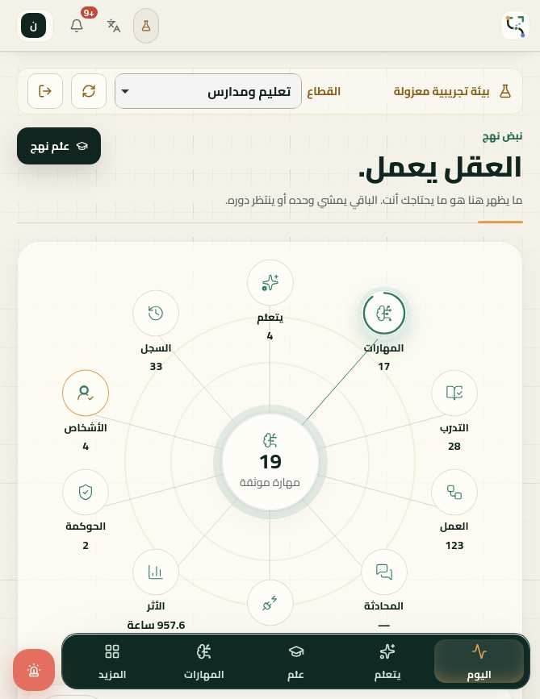
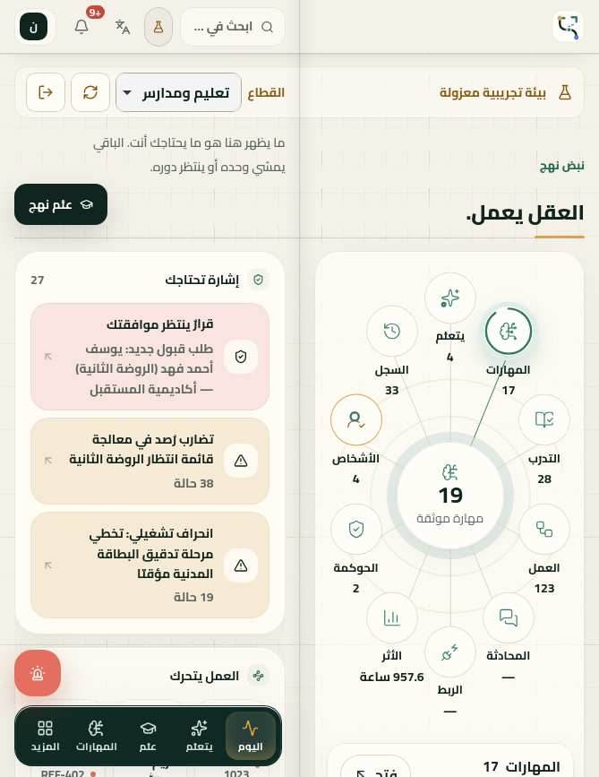
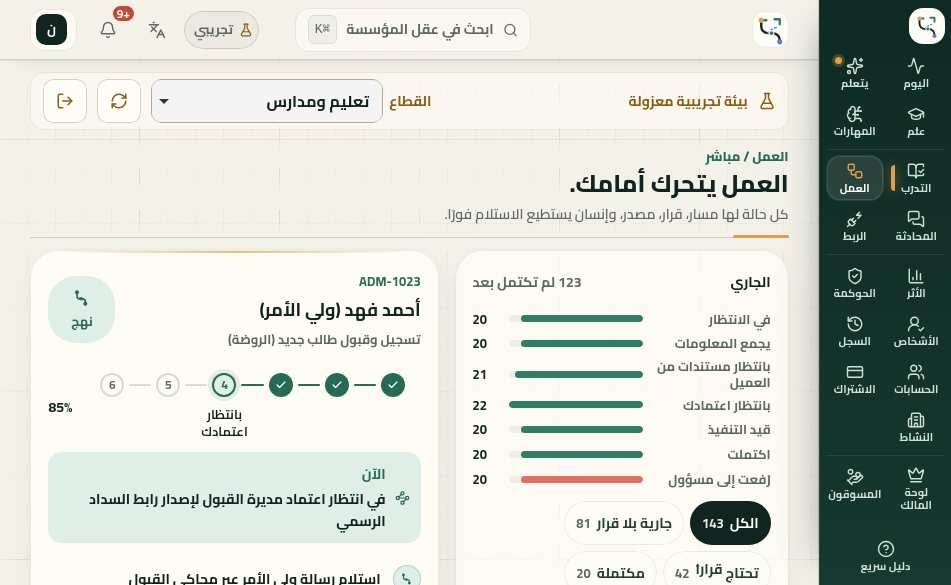
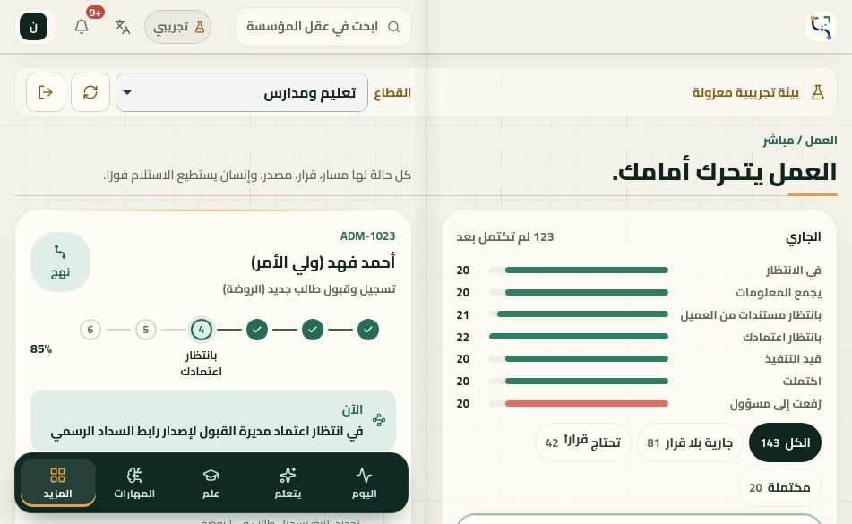
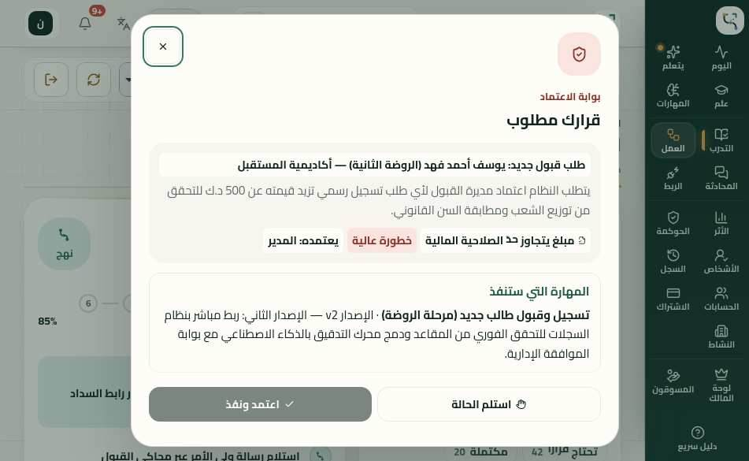
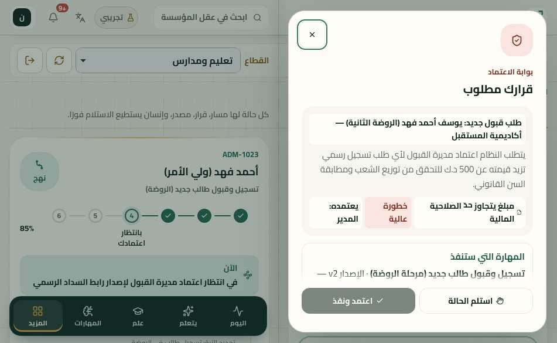
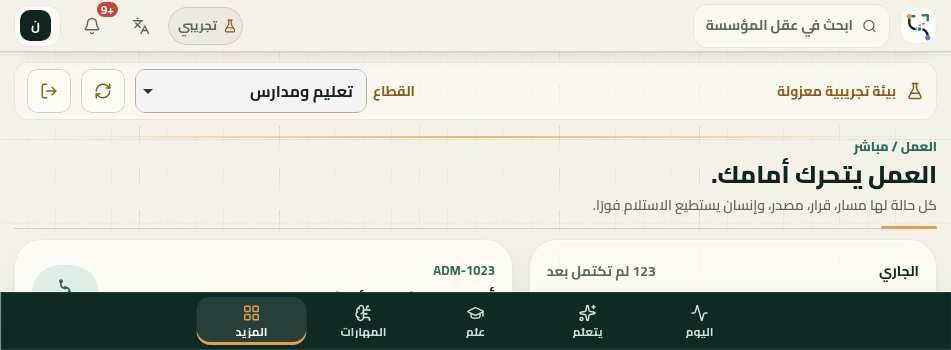

# نهج على iPhone Duo — قبول الجولة الأخيرة: وضع الكتاب ومصفوفة الوضعيات (14 نوفمبر 2026)

هذه الجولة تبني على [IPHONE-DUO-ADAPTIVE-QUALITY.md](IPHONE-DUO-ADAPTIVE-QUALITY.md) ولا تعيد ما حُلّ فيها (الحواف الآمنة بجهاتها، وشريط القرار اللاصق، ولوحتا الدخول في الارتفاع القصير).

**النطاق: طبقة العرض وحدها.**
- [src/duo-adaptive.css](../src/duo-adaptive.css): الأقسام ٥ (وضع الكتاب) و٦ (وضع الحاسوب)، وقائمة «كل الأقسام» فوق 900px، وأهداف لمس.
- [src/components/views/DemoOwnerPreview.tsx](../src/components/views/DemoOwnerPreview.tsx): الجذر صار `<div className="page-enter">` بدل `<>`، كبقية الأقسام، فيوزّعه وضع الكتاب على الصفحتين. لا تغيير في البيانات ولا النصوص.
- [server/duoLayout.test.ts](../server/duoLayout.test.ts): اختباران جديدان. الاختبارات القديمة كما هي.
- [docs/iphone-duo-final/audit.cjs](iphone-duo-final/audit.cjs): سكربت التدقيق، وصور قبل/بعد.

لم يُمسّ سلّم الاعتماد ولا السياسات ولا المصادقة ولا Firestore ولا الدفع ولا البيانات ولا المسارات ولا الـ workflows ولا النشر.

رموز الحالة: `PASS` مقيسٌ ومُشاهَد في الصور، و`PARTIAL` يعمل مع ملاحظة، و`FAIL` خلل باقٍ، و`BLOCKED` لا يُبلغ بلا بيانات أو صلاحية حقيقية، و`NOT_TESTED` لم يُختبر. كل الاختبارات في Playwright WebKit (UA سفاري الهاتف، لمس، `deviceScaleFactor: 1`). **لم يُختبر شيء على جهاز حقيقي.**

## 1. المشكلة والتصميم

على الشاشة الداخلية (≈669×867 طولياً و≈951×585 عرضياً) كانت الواجهة صفحة iPad ممطوطة: شريطٌ جانبي وعمودٌ واحد يعبر منتصف الشاشة. قِيس ذلك قبل التعديل: **303 نصّاً أو عنصراً تفاعلياً يقطع منطقة الكعب على 669×867، و276 على 951×585** (25 حالة في كل مقاس).

Safari لا يكشف المفصل، فالقرار بالمقاس وحده (وكل القواعد مقيّدة بـ `screen`):
- كتاب طولي: `640–720 × ≥760`. كتاب عرضي: `860–1000 × 520–760`. فلا يقع فيه iPad طولي (768×1024) ولا 1024×768 ولا 669×520.

**التركيب:**
- **صفحتان متقابلتان** وكعبٌ هادئ عرضه 32px (`--spine`): خيطٌ وسطي وظلّ طيّ خفيف، لا يلتقط اللمس. والخلفية متصلة من الحافة إلى الحافة، والحاشية متناظرة (`max(16px, safe-l, safe-r)`) فيبقى الكعب في منتصف الشاشة حتى مع حافة آمنة على جهة واحدة.
- **اليمنى (البداية في RTL) للمهمة**: القائمة أو القراءة أو المحادثة أو الخريطة. **اليسرى للسياق**: لوحةٌ واحدة بطول الصفحة **تلصق تحت الرأس** فتبقى أمام العين بينما تتمرّر المهمة.
- **رأس القسم سطرٌ يقسمه الكعب**: العنوان يميناً، والتمهيد وزرّ القسم يساراً.
- **الرأس العام**: الهوية يميناً، والبحث والأدوات يساراً. **شريط العرض التجريبي**: الوصف يميناً، والقطاع والأزرار يساراً.
- **الفهرس (التنقّل)** ينتقل من الشريط الجانبي إلى أسفل الصفحة اليسرى، و«المزيد» يفتح كل الأقسام على الصفحة اليسرى. زرّ الإيقاف الطارئ فوق الفهرس عند الحافة الخارجية.
- **النوافذ**: الستار بعرض الشاشة كلها ويحجب اللمس. الاعتماد والإيقاف والترقية والبحث على اليمنى، والدليل على اليسرى.

| القسم | اليمنى (المهمة) | اليسرى (السياق، لاصقة) |
|---|---|---|
| اليوم | خريطة العقل التشغيلي + النبض + الذاكرة | «إشارة تحتاجك» و«العمل يتحرك» |
| يتعلّم | موجز الإشارات | رادار الإشارات |
| علّم | منصة الجلسة | الالتقاط المباشر |
| المهارات | خريطة المهارات | مفتش المهارة المختارة |
| التدرّب | مسار التخرّج + التقييم | مقارنة الظل |
| العمل | طابور الحالات والفلاتر | الحالة المختارة ومسارها |
| المحادثة | الهاتف والمحادثة | أثر المحادثة |
| الربط | حالة المرآة + قائمة الموصلات | خريطة الأنظمة |
| الأثر | الأثر والمقاييس والأسبوع والمخاطر | أكثر المهارات أثراً |
| الحوكمة | الدرع + سلّم الاستقلالية | حواجز القرار |
| الأشخاص | التغطية + المصفوفة + القائمة | مخاطر الشخص الواحد |
| السجل | الخط الزمني للأدلة | الكثافة والأنواع والبحث و«عرض المزيد» |
| الحسابات | قائمة الحسابات | كلمة مروري + حساب جديد |
| الاشتراك | الحالة والاستهلاك والتصدير والسجلات | الباقات |
| النشاط | الأنشطة الجاهزة | الملاحظة + من يحادث مؤسستك |
| لوحة المالك / المسوّقون (معاينة العرض) | الملاحظة والجداول | المؤشرات |
| الدخول | الهوية والتعليمات | النموذج في بطاقة |
| إعداد المؤسسة | الاسم والملاحظة وزرّ البدء | القطاعات |

**الآلية:** `.page-enter` (جذر كل قسم) شبكةٌ بعمودين متساويين بينهما فاصلٌ بعرض الكعب. وحاويات «قائمة | تفاصيل» تصير `display: contents`، فيُوزَّع أبناؤها بلا تغيير في الشجرة ولا JS ولا إعادة تركيب. لذا تبقى الحالة عبر تغيّر المقاس.

جُرِّب العمود المتعدد (`columns: 2`) أولاً ثم تُرك: WebKit لا يرسم العنصر الموضَّع (`position: relative` في `.surface-strong`) إذا وقع في العمود الثاني. يُلمس ولا يُرى. والاختبار الجديد يمنع العودة إليه.

**وضع الحاسوب (E) والارتفاع القصير العريض (B، 844×390):** `≥560 × ≤430`. المحتوى بالعرض كله، والرأس يتمرّر مع الصفحة، والأدوات شريطٌ ملتصق بالحافة السفلية بعرض الشاشة وأزراره في الوسط. وللمحتوى حشوةٌ سفلية بارتفاعه، و`scroll-padding-bottom` يمنع الحقل المركَّز من الاختفاء تحته. هذا يستبدل الشريط الجانبي ذا العمودين في الارتفاع القصير (الجولات 117–119) بشريطٍ سفلي، كما تطلب مواصفة وضع الحاسوب.

**مفصل حقيقي (Viewport Segments):** لم يُضَف. المستودع يحرس صراحةً ألا يعتمد أي تخطيط على `viewport-segments` أو `device-posture` ([duoLayout.test.ts](../server/duoLayout.test.ts))، وWebKit لا يحاكيها. الحالة: `NOT_TESTED`. والكعب في المنتصف الهندسي، وهو موضع المفصل في الوضع الكامل.

## 2. جرد الشاشات (من `App.tsx` و`Shell.tsx`)

| # | الشاشة | كيف بُلغت |
|---|---|---|
| 1 | الدخول (إنشاء أول حساب / تسجيل الدخول) | سياق مجهول |
| 2 | إعداد المؤسسة (`OrgSetupView`) | حساب محلي في قاعدة الذاكرة (`NAHJ_DATABASE_PATH=:memory:`) |
| 3–19 | الأقسام السبعة عشر: اليوم، يتعلّم، علّم، المهارات، التدرّب، العمل، المحادثة، الربط، الأثر، الحوكمة، الأشخاص، السجل، الحسابات، الاشتراك، النشاط، لوحة المالك، المسوّقون | الصندوق التجريبي المعزول (`/api/demo/enter`) |
| 20 | نافذة الاعتماد | زر التنبيهات |
| 21 | نافذة الإيقاف الطارئ | الزر العائم، أو «إيقاف طارئ» في الحوكمة فوق 900px |
| 22 | نافذة مراجعة الترقية | سلّم الاستقلالية في المهارات (فتحٌ فقط، بلا ترقية) |
| 23 | لوحة البحث والتنقّل | زر البحث، أو من «المزيد» |
| 24 | الدليل السريع | زر الدليل، أو من «المزيد» |
| 25 | قائمة «كل الأقسام» | زر «المزيد» في الفهرس |
| 26 | تبويبات «العمل» (الكل، جارية، تحتاج قراراً، مكتملة…) وأنواع «السجل» | نقر كل تبويب |
| 27 | شريط العرض التجريبي (القطاع، الإعادة، الخروج) | ظاهر في كل الأقسام |
| — | بوابة التحقق (`boot-gate`)، وحالات «جارٍ التحميل» في الاشتراك والنشاط ولوحة المالك | لحظية. لم تُلتقط عمداً: `NOT_TESTED` |
| — | حالة الخطأ (تعذّر الخادم) والإشعارات (toast) | `NOT_TESTED` |
| — | الاشتراك الفارغ (`sub-empty`) | يحتاج مؤسسة حقيقية بلا لقطة ترخيص: `NOT_TESTED` |
| — | لوحة المالك الحقيقية (`OwnerView`) ودفتر المسوّقين الحقيقي (`PartnersAdminView`) | تحتاج حساب مالك حقيقي وبيانات ترخيص: `BLOCKED`. المعاينة التجريبية مختبرة |
| — | بوابة المسوّق (`PartnerPortalView`، دور partner) | تحتاج حساب مسوّق: `BLOCKED` |

## 3. القياس (Playwright WebKit، [audit.cjs](iphone-duo-final/audit.cjs))

لكل مقاس × شاشة يقاس: التمرير الأفقي (`scrollWidth − clientWidth`)، وأهداف اللمس الأصغر من 44px، والعناصر المقصوصة أفقياً. وفي مقاسات الكتاب يقاس كل نصّ (بمستطيلات `Range` الفعلية) وكل عنصر تفاعلي يقطع منطقة الكعب (المنتصف ± 16px)، بعد قصّه بحدود حاويات التمرير. وأشرطة التمرير مخفية كي تطابق أشرطة iOS الطافية.

| الوضعية | المقاسات | الحالات | تمرير أفقي | قطع الكعب (قبل → بعد) | مقصوص | أهداف < 44px (قبل → بعد) |
|---|---|---|---|---|---|---|
| A مطوي طولي | 382×580، 385×571، 320×568 | 75 | 0 | — | 0 | 19 → 6 |
| B مطوي عرضي | 594×368 | 25 | 0 | — | 0 | 7 → 2 |
| C كتاب طولي | 669×867 | 25 | 0 | **303 → 0** | 0 | 5 → 0 |
| D كتاب عرضي | 951×585 | 25 | **1 → 0** | **276 → 0** | **1 → 0** | 10 → 0 |
| E حاسوب | 951×350، 600×350 | 50 | **1 → 0** | — | **1 → 0** | 18 → 4 |
| F داخلي قصير | 669×520، 600×480 | 50 | 0 | — | 0 | 4 (بعد) |
| G لوحي/مكتب | 768×1024، 1024×768، 1280×800، 1440×900 | 100 | 0 | — | 0 | 829 (بعد؛ انظر P2) |
| H هواتف | 360×640، 390×844، 844×390 | 75 | 0 | — | 0 | 6 (بعد) |
| عروض إضافية | 320/470/620 × 350/600/900 | 225 | 0 | — | 0 | 20 (بعد) |

خط الأساس (`origin/main` = `2a8a4ac`) قِيس بالسكربت نفسه للوضعيات A–E فقط.

**الستار يحجب اللمس** (669×867 و951×585): فُتحت نوافذ الاعتماد والإيقاف والترقية والبحث والدليل. فحص `elementFromPoint` في منتصف كل صفحة يعيد الستار أو النافذة، ولا يعيد ما تحتها: **10/10**. ومواضع النوافذ: الاعتماد والإيقاف والترقية والبحث بين x=351 و659 (اليمنى، 669) وبين 492 و935 (اليمنى، 951)، والدليل بين 0 و460 (اليسرى).

**التبويبات:** نُقر كل تبويب في «العمل» و«السجل» على 669×867 و951×585 و382×580. التمرير الأفقي بعد كل نقرة: **0** في 27 نقرة.

## 4. مصفوفة الوضعيات A–J

A–H من القياس أعلاه، ومن الصور التي فحصتُها لكل شاشة في 669×867 و951×585 و951×350 و600×350 و594×368 و382×580. وI وJ مفصّلتان في القسمين 5 و6.

| الشاشة | A | B | C | D | E | F | G | H | I | J |
|---|---|---|---|---|---|---|---|---|---|---|
| الدخول | PASS | PASS | PASS | PASS | PASS | PASS | PASS | PASS | NOT_TESTED¹ | PASS |
| إعداد المؤسسة | PASS | PASS | PASS | PASS | PASS | PASS | PASS | PASS | NOT_TESTED¹ | PARTIAL² |
| اليوم | PASS | PASS | PASS | PASS | PASS | PASS | PASS | PASS | PASS | PASS |
| يتعلّم | PASS | PASS | PASS | PASS | PASS | PASS | PASS | PASS | PASS | PARTIAL² |
| علّم | PASS | PASS | PASS | PASS | PASS | PASS | PASS | PASS | PASS | PARTIAL² |
| المهارات | PASS | PASS | PASS | PASS | PASS | PASS | PASS | PASS | PASS | PARTIAL² |
| التدرّب | PASS | PASS | PASS | PASS | PASS | PASS | PASS | PASS | PASS | PARTIAL² |
| العمل (+ تبويباته) | PASS | PASS | PASS | PASS | PASS | PASS | PASS | PASS | PASS | PASS |
| المحادثة | PASS | PASS | PASS | PASS | PASS | PASS | PASS | PASS | PASS | PARTIAL² |
| الربط | PASS | PASS | PASS | PASS | PASS | PASS | PASS | PASS | PASS | PARTIAL² |
| الأثر | PASS | PASS | PASS | PASS | PASS | PASS | PASS | PASS | PASS | PARTIAL² |
| الحوكمة | PASS | PASS | PASS | PASS | PASS | PASS | PASS | PASS | PASS | PARTIAL² |
| الأشخاص | PASS | PASS | PASS | PASS | PASS | PASS | PASS | PASS | PASS | PARTIAL² |
| السجل (+ أنواعه) | PASS | PASS | PASS | PASS | PASS | PASS | PASS | PASS | PASS | PASS |
| الحسابات | PASS | PASS | PASS | PASS | PASS | PASS | PASS | PASS | PASS | PASS |
| الاشتراك | PASS | PASS | PASS | PASS | PASS | PASS | PASS | PASS | PASS | PARTIAL² |
| النشاط | PASS | PASS | PASS | PASS | PASS | PASS | PASS | PASS | PASS | PARTIAL² |
| لوحة المالك (معاينة) | PASS | PASS | PASS | PASS | PASS | PASS | PASS | PASS | PASS | PARTIAL² |
| المسوّقون (معاينة) | PASS | PASS | PASS | PASS | PASS | PASS | PASS | PASS | PASS | PARTIAL² |
| نافذة الاعتماد | PASS | PASS | PASS | PASS | PASS | PASS | PASS | PASS | PASS | PARTIAL² |
| نافذة الإيقاف الطارئ | PASS | PASS | PASS | PASS | PASS | PASS | PASS | PASS | PASS³ | PARTIAL² |
| مراجعة الترقية | PASS | PASS | PASS | PASS | PASS | PASS | PASS | PASS | PASS³ | PARTIAL² |
| البحث والتنقّل | PASS | PASS | PASS | PASS | PASS | PASS | PASS | PASS | PASS³ | PARTIAL² |
| الدليل السريع | PASS | PASS | PASS | PASS | PASS | PASS | PASS | PASS | PASS³ | PARTIAL² |
| «كل الأقسام» | PASS | PASS | PASS | PASS | PASS | N/A⁴ | N/A⁴ | PASS | PASS³ | PARTIAL² |
| لوحة المالك الحقيقية، بوابة المسوّق | BLOCKED | BLOCKED | BLOCKED | BLOCKED | BLOCKED | BLOCKED | BLOCKED | BLOCKED | BLOCKED | BLOCKED |
| التحميل والخطأ والاشتراك الفارغ | NOT_TESTED | NOT_TESTED | NOT_TESTED | NOT_TESTED | NOT_TESTED | NOT_TESTED | NOT_TESTED | NOT_TESTED | NOT_TESTED | NOT_TESTED |

1. الانتقال الحي اختُبر داخل التطبيق (القسم 5). وشاشتا الدخول والإعداد مقيستان في كل المقاسات، لكن لم يُجرَ عليهما تسلسل تغيير المقاس في جلسةٍ واحدة.
2. ضغط الوصول (J) قيس على اليوم والعمل والسجل والحسابات في أربعة مقاسات، والدخول في كل المقاسات. والباقي يشترك في الطبقة نفسها لكنه لم يُقس منفرداً تحت كل ضغط.
3. نفس الآلية (الستار ثابت بعرض الشاشة، والنافذة لا تُعاد تركيبها)، والاختبار الحي على نافذة الاعتماد.
4. فوق 900px خارج الكتاب والحاسوب، وفي 669×520 و600×480 (الشريط الجانبي)، كل الأقسام ظاهرة فلا قائمة «المزيد».

## 5. I — الانتقال الحي بلا إعادة تحميل

صفحةٌ واحدة: السجل، وفي بحثه «تدقيق-دو»، والصفحة ممرَّرة، ثم نافذة الاعتماد مفتوحة وفيها سبب مكتوب. ثم:
951×585 → 669×867 → 470×700 → 382×580 → 594×368 → 951×350 → 951×585.

| المقاس | النافذة مفتوحة | السبب باقٍ | البحث باقٍ | القسم باقٍ | زرّا القرار ظاهران | تمرير أفقي |
|---|---|---|---|---|---|---|
| كل الخطوات السبع | ✓ | ✓ | ✓ | ✓ | ✓ | 0 |

النتيجة: **PASS** (`report.live` كله `ok`). الصور: `I-*.jpg` في مجلّد الناتج.

## 6. J — ضغط الوصول

قيس على 382×580 و669×867 و951×585 و951×350 × (اليوم، العمل، السجل، الحسابات):

| الضغط | النتيجة |
|---|---|
| نص 200% (`html{font-size:200%}` و`-webkit-text-size-adjust:200%`) | تمرير أفقي 0، وقطع الكعب 0. PASS. معظم أحجام الخط في التطبيق بالـ px فلا تكبر كلها. على الجهاز يتحكّم «حجم النص» في iOS، وهذا لم يُختبر |
| الوضع الداكن (`colorScheme: dark`) | التطبيق بلا سمة داكنة: يبقى بهويته الورقية الفاتحة سليماً، تمرير 0، وقطع الكعب 0. PASS (لا توجد سمة داكنة لتُختبر) |
| الحركة (`no-preference` مقابل `reduce`) | في الكتاب تُطفأ حركة دخول القسم، ولا حركة مستمرة جديدة. PASS |
| لوحة المفاتيح (حقل البحث مركَّز ثم الارتفاع 360/300/330) | الحقل داخل الشاشة ولا يغطيه الفهرس في المقاسات الثلاثة. **قبل إصلاح `scroll-padding` كان مغطّى على 951×300.** PASS (محاكاة) |
| حواف آمنة غير متناظرة (47px يميناً أو يساراً) | الكعب يبقى في المنتصف، وقطع الكعب 0، وتمرير 0. PASS (محاكاة بمتغيّرات `--safe-*`) |
| الطباعة (`media: print` على 669) | `.page-enter` ليس شبكة كتاب. القواعد مقيّدة بـ `screen`. PASS |

## 7. صور قبل/بعد (الشاشة الداخلية)

| | قبل | بعد |
|---|---|---|
| C 669×867 — اليوم |  |  |
| D 951×585 — العمل |  |  |
| D 951×585 — نافذة الاعتماد |  |  |
| E 951×350 — العمل (وضع الحاسوب) |  |  |

## 8. ما بقي

**P0:** لا شيء معروف.

**P1**
- لم يُختبر شيء على iPhone Duo حقيقي. حدود «الكتاب» تقديرٌ من المقاسات المعطاة (669×867 و951×585). إن اختلفت أبعاد Safari الفعلية خارج المديين `640–720 × ≥760` و`860–1000 × 520–760`، فستظهر الواجهة بتخطيط الجهاز اللوحي السابق، لا مكسورة.
- E/B: الشريط الجانبي ذو العمودين في الارتفاع القصير (الجولات 117–119) صار شريطاً سفلياً بأربعة أقسام و«المزيد». والأقسام السبعة عشر كلها في «المزيد». وهذا تغيّرٌ مقصود في التنقّل ينبغي أن يراه المالك.

**P2**
- على 951×350 يأكل الرأس وشريط العرض التجريبي ورأس القسم قرابة نصف الارتفاع قبل المحتوى. كلها تتمرّر مع الصفحة، وشريط العرض لا يظهر خارج العرض التجريبي.
- G (1280×800 و1440×900): أزرار الشريط الجانبي بارتفاع 34–38px (كانت كذلك قبل، وهي كثافة مقصودة لمؤشر الفأرة). المحاكي يعلن لمساً في كل المقاسات، فتُعدّ هنا.
- وبقي أهداف صغيرة متفرقة سابقة في A وH والعروض الإضافية (روابط تذييل الدخول، و`summary` بارتفاع 40px قبل هذه الجولة). أُصلح بعضها تحت `(pointer: coarse)`. والقائمة في `report.json`.
- لوحة السياق اللاصقة تتمرّر داخلياً حين تطول (الباقات، الالتقاط). سلوكٌ مقصود، لكن يحسن تجربته باللمس.

## 9. التشغيل وإعادة التدقيق

```sh
npm ci
PORT=5201 NAHJ_FIREBASE_SYNC=off NAHJ_DATABASE_PATH=:memory: npx tsx server.ts      # خادم تطوير محلي، قاعدة في الذاكرة
NODE_PATH=/opt/node22/lib/node_modules PLAYWRIGHT_BROWSERS_PATH=/opt/pw-browsers \
  node docs/iphone-duo-final/audit.cjs /tmp/duo-audit                               # NAHJ_URL لعنوان آخر
# DUO_POSES=C,D DUO_QUICK=1 لمصفوفةٍ مختصرة
```

الناتج في `/tmp/duo-audit/report.json` (`summary.byPose`، و`live`، و`modals`، و`tabs`، و`stress`)، والصور في `/tmp/duo-audit/shots`. السكربت ينشئ حساباً محلياً في قاعدة الذاكرة ليبلغ «إعداد المؤسسة»، ولا يكتب شيئاً خارجها.

الفحوص: `npm run typecheck` PASS، و`npm test` PASS (345/345، منها 2 جديدان)، و`npm run build` PASS. ولا فشل سابق على `main`.

## 10. قائمة المالك على الجهاز الحقيقي

1. افتح Duo كتاباً طولياً (669×867 تقريباً) على «العمل»: القائمة يميناً، والحالة المختارة يساراً، والكعب في المنتصف تماماً فوق المفصل. اختر حالةً من أسفل القائمة، فتتغيّر اللوحة اليسرى وتبقى ظاهرة.
2. اقلب الجهاز عرضياً (951×585): الصفحتان ما تزالان متقابلتين، والفهرس أسفل اليسرى. افتح «المزيد» ثم «السجل».
3. افتح «قرار مطلوب» واكتب سبباً، ثم اطوِ الجهاز وافتحه: تبقى النافذة ويبقى السبب، وتجلس النافذة على الصفحة اليمنى. انقر على الصفحة اليسرى: لا يتفاعل ما تحت الستار.
4. وضع الحاسوب (951×350): الأزرار شريطٌ سفلي لا يغطي آخر المحتوى. ركّز حقل البحث في «السجل»: لا تخفيه لوحة المفاتيح ولا الشريط.
5. الشاشة الخارجية (382×580 و594×368): مهمةٌ واحدة واضحة، والخلفية حتى الحواف.
6. «حجم النص» الأكبر في iOS، وVoiceOver على صفحتي «العمل»: ترتيب القراءة يمين ثم يسار.

## 11. النشر

الدمج في `main` لا ينشر شيئاً. مُشغِّل Cloud Build `nahj-deployer` معطّل، و[.github/workflows/deploy.yml](../.github/workflows/deploy.yml) يدوي (`workflow_dispatch`) ومسارٌ احتياطي لخادم VM، ومتغيّرات `GCP_*` غير مضبوطة فيه. والإنتاج (`https://nahj-os.web.app` ← Cloud Run `nahj`) يُنشر يدوياً من نسخة نظيفة من `main`:

```sh
gcloud builds submit --config cloudbuild.yaml --substitutions=COMMIT_SHA=$(git rev-parse HEAD) --project nahj-a27a4
```

وللتحقق بعده: `https://nahj-os.web.app/api/health`، وأن يحوي ملف CSS الحي `--spine`. هذه الجولة لم تنشر شيئاً.

## 12. Duo ≠ iPad

وضع الكتاب ووضع الحاسوب لشاشة iPhone Duo الداخلية وحدها؛ الـ iPad يبقى على تخطيط الأجهزة اللوحية/المكتبية كما كان. الفاصل الوحيد الموثوق في Safari هو حجم النافذة (الداخلية ≈ 669×867 طولياً و951×585 عرضياً، وأصغر iPad عرضه 744 طولياً و1024 عرضياً).

| الاستعلام (كلها مقيّدة بـ `screen`) | المدى | يطابق مقاس iPad؟ |
|---|---|---|
| كتاب طولي | عرض 640–720 وارتفاع ≥ 760 | لا |
| كتاب عرضي | عرض 860 (أو 901) إلى 1000 وارتفاع 520–760 | لا |
| حاسوب | عرض ≥ 560 وارتفاع ≤ 430 | لا |

نتيجة المسبار ([ipad-probe.cjs](iphone-duo-final/ipad-probe.cjs)، WebKit، شاشات «اليوم» و«العمل» و«الحوكمة» + نافذة قرار الاعتماد):

- 23 مقاس iPad: كاملة الشاشة (744×1133، 768×1024، 810×1080، 820×1180، 834×1112، 834×1194، 1024×1366 وعرضياتها) ومع شريط Safari (744×1040، 768×920، 768×950، 810×990، 820×1090، 834×1020، 1024×690، 1133×660، 1180×735): لا استعلام Duo يطابق، شبكة القسم والكعب وشريط الأسفل غير فعّالة، وحذف كتل Duo من الـ CSSOM لا يغيّر أي مستطيل. حشوة ستار النافذة 10px أو 18px لا حشوة الكتاب.
- مقاسات Duo: 669×867، 660×800، 700×900، 720×900، 951×585، 880×585، 1000×600 تبقى كتاباً.
- حارس الاختبار في `server/duoLayout.test.ts` يفشل إن تجاوز سقف الكتاب الطولي 720px أو العرضي 1000px أو غاب `screen`.

**قيد معروف:** نافذة iPad في Split View أو Slide Over بعرض ≈ 640–720px لا تُفرَّق عن الـ Duo بالحجم؛ والفاصل الحقيقي `(horizontal-viewport-segments: 2)` لا يعمل إلا حيث يكشفه المتصفح، والاختبارات تمنع الاعتماد عليه.

**P2 للمالك:** وضع «نصف مفتوح» 669×520 يعرض الشريط الجانبي لا الكتاب، بالتصميم؛ القرار: هل يُراد كتابٌ هناك أيضاً؟

---

## الجولة الثانية (نوفمبر 2026): تصحيح حدود الكتاب، وحجب ودجت النظام

> هذه الفقرة تلغي ما سبقها بشأن الكتاب الطولي (`640–720 × ≥760`) والعرضي (`860–1000 × 520–760`).

- **الكتاب = أفقي فقط:** `screen and (min-width:721px) and (max-width:1000px) and (min-height:520px) and (max-height:960px) and (orientation:landscape)`. الطولي على الشاشة الداخلية (≈669×867) صار عموداً واحداً كالهاتف الواسع بلا كعب ولا نصف صفحة؛ ولوحتا «قائمة|تفاصيل» في `duo.css` لا تنطبقان على الطولي ≤720.
- **الأحجام تتبع الصفحة:** كل خلية كتاب حاوية (`container-type:inline-size`) بعرض الصفحة ≈ 460px، ومؤشرات «اليوم» (`.pulse-stats`) عمودان بعد أن كانت أربعة بعرض النافذة (951px) فتُسحق إلى حرفٍ في السطر. الجداول العريضة تتمرّر داخل الصفحة.
- **الكعب يبدأ تحت الشريط العلوي:** الشريط بعرض الشاشة كلها عن قصد (الهوية على الصفحة الأولى، والأدوات على الثانية)؛ والفهرس السفلي على صفحة واحدة.
- **ودجت النظام (أعلى اليمين الفيزيائي، حوالي 116×116):** يُحجز على الشاشة الداخلية (الكتاب + الطولي 640–720) **في تبويب المتصفح وفي التطبيق المثبّت معاً** (لا شرط `display-mode`؛ الجولة الثالثة أزالته لأن المالك يستعمل Safari كتبويب). `--duo-cutout-w/h = 116px`: النطاق العلوي بارتفاعه، والهوية/الأدوات عند الحافة اليمنى تتراجع (RTL وLTR)، والنوافذ والبحث والدليل تبدأ تحت المنطقة. الطيّ الخارجي (367×740) لا يُميَّز عن iPhone عادي فلا يُخمَّن.
- **غير مُختبَر على جهازٍ حقيقي.** القياس بمحاكاة المتصفح؛ وبعد الجولة الثالثة لا حاجة لمحاكاة standalone: الحجب يُقاس مباشرة بمحاكاة المقاسات في تبويب عادي.
